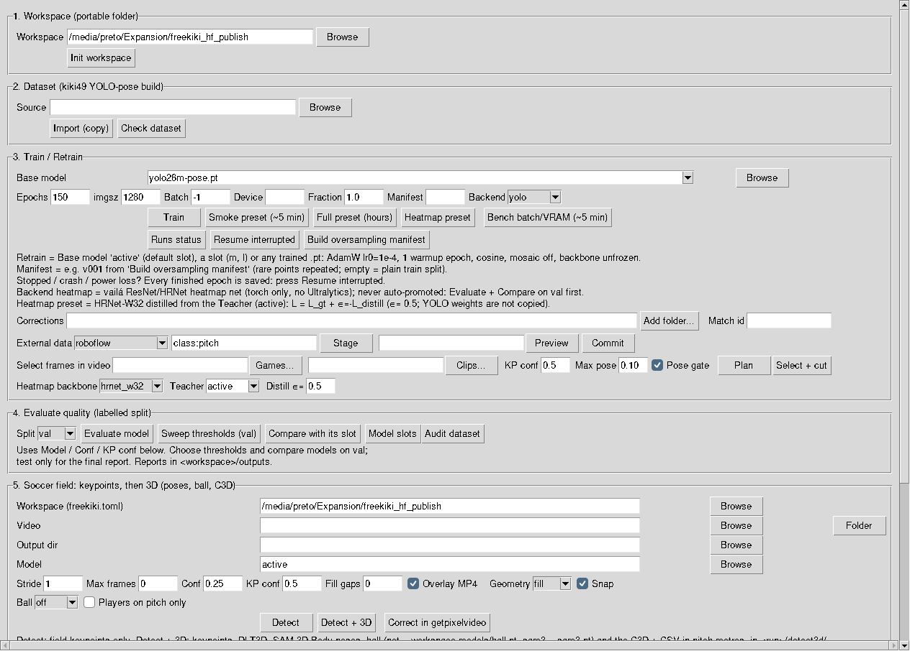
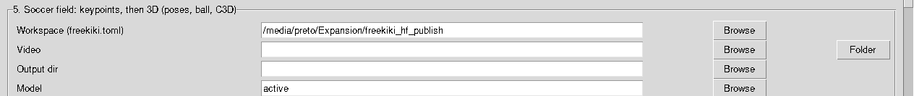
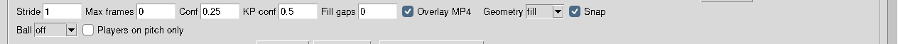
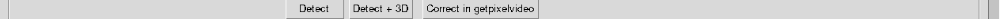

# freekiki

## Module Information

- **Category:** Multimodal Analysis / Sports Field Calibration
- **File:** `vaila/freekiki.py`
- **Version:** 0.4.12
- **Updated:** 29 October 2026
- **Author:** Paulo Santiago — paulosantiago@usp.br
- **GUI Interface:** Yes (Tkinter) — **Frame B → Soccer Tools → FreeKiki (49 field KPs)**
- **CLI Interface:** Yes
- **License:** AGPL-3.0

---

## What it does (in one paragraph)

### Correct and retrain (3 steps)

1. **Detect**, then **Correct in getpixelvideo** (section 5). A folder of videos opens them one after the
   other.
   - Or, in getpixelvideo, press **Tpl:** and type **L** (FreeKiki Load), or use the **Load run folder** button
     of the FreeKiki panel. Open the run or batch folder in the
     browser and press **Enter** to use it. It finds the original video and opens it in correction mode; for a
     batch it asks which video. The CLI equivalent is `getpixelvideo.py --freekiki-run DIR`.
   - The predicted labels appear on the video, already in edit (INSERT) mode.
2. **Fix** every frame you want to use.
   - **Right-click** a point to pick it; **left-click** to place it where it belongs.
   - Missing points: pick them in the list or with the ghost, then left-click. **F10** accepts a ghost.
   - A point that is inside the picture but not visible: **Del** (this frame) or **Del Range** (that point over
     many frames). Points outside the picture are ignored.
   - **F3 Frame OK** when the frame is right. **Next draft (PgDn)** goes to the next frame.
   - **X / Discard** drops a bad frame (advert, wrong camera, blur, replay graphics). It loses its
     points, is never exported, and **disappears from navigation**: arrows, slider, playback and
     PgDn jump over it. **Shift+X** shows the discarded frames again (dark, labelled
     *DISCARDED*); X on one of them restores the network draft. The montage video itself is not
     cut, so the frame numbers of labels already ingested stay valid.
   - **F9 Save** (or panel **Save (F9)** button) asks whether to save **Full** (1) or **Lite** (2):
     - **Full mode (1):** saves the complete dataset with both human-reviewed frames and uncorrected AI predicted frames (images + labels) into `freekiki_full_<video>`, allowing the network to train on the entire footage.
     - **Lite mode (2):** writes only human-reviewed frames into `freekiki_corrections_<video>`; incomplete frames remain as drafts and are listed in `incomplete_frames.csv`.
3. In section 3, **Corrections → Add folder…** (several videos: several folders), then **Train**.
   - Base `active` gives a fine-tune.
   - The folders are added to the train split once, with the same leakage and duplicate checks as `ingest`, and
     then the training starts.
   - **Match id** is optional. The default is the video name; give clips of one match the same id.
   - CLI: `train -w WS --base active --add-dataset FOLDER [--add-dataset FOLDER2] [--match-id M]`.
     Do not combine it with `--manifest`, because a manifest is a fixed list without the new frames.

### Mine new videos for the missing keypoints (`queue --need`, one montage)

Use the trained network to find, in many new videos, the frames that show the
keypoints it still misses. Put them in **one** review video.

```bash
# 1. download (vailá-ready H.264, clean names), then detect every video (geometry on by default)
uv run --no-sync vaila/vaila_ytdown.py --file urls.txt --output ~/data/yt_mining --no-gui
uv run --no-sync vaila/freekiki.py detect -w WS --video ~/data/yt_mining/vaila_batch_<ts> --model l --stride 5 --no-overlay --output-dir ~/data/yt_mining/detect
# 2. frames whose field camera puts p5 / p29 / p39 / p47 in the picture -> one montage session
uv run --no-sync vaila/freekiki.py queue -w WS --batch ~/data/yt_mining/detect/processed_freekiki_batch_<ts> --need p5,p29,p39,p47 --montage
# 3. review the montage (command printed by queue), F9 saves the dataset in the montage folder
# 4. one match per source video, taken from montage_frames.csv
uv run --no-sync vaila/freekiki.py ingest -w WS --src WS/incoming/montage_<ts>            # preview
uv run --no-sync vaila/freekiki.py ingest -w WS --src WS/incoming/montage_<ts> --commit
```

How the frames are chosen. For each frame, the field camera is fitted to the
points the network accepted (see *Field geometry*). It says whether a
**needed** keypoint lies inside the picture, even when the network does not
find it. The priority:

1. camera: the point is in the picture and the network **misses** it (the most
   useful labels);
2. only with `--half-seen`: no camera, but the network half-sees the point (conf ≥ 0.1).
   It is off by default because reviewers discarded all such frames (105 of 105): adverts,
   replays and close-ups;
3. camera: the point is in the picture and the network already accepts it.

Frames without any needed point are skipped. With `--need`, at most
`--per-video` (default **5**) frames are taken per video, at least `--min-gap`
apart: many videos with few frames each give the variety the network lacks.
`--batch` takes several folders.

`--montage` writes `WS/incoming/montage_<ts>/` with:

- `montage.mp4`: H.264 with every frame a key frame, so seeking is exact;
  videos of another size are letterboxed to the most common size;
- `session.json`: the network predictions drafted on every frame;
- `montage_frames.csv`: for each montage frame, its source `video`, `frame`,
  `time_s`, letterbox `scale` / `offset`, the reason it was chosen and its
  `match`.

`match` defaults to the source video name; cuts of one video
(`…_frame_A_to_B`) share it. Edit the column before `ingest` to give clips of
the same match one id. `ingest` without `--match-id` groups each frame by that
column, so the val/test/hard leakage checks work per match. The manifest
keeps `source_video` / `source_frame`.

### Advanced (CLI): label queue, ingest, hard holdout

```bash
# 1. detect, then queue the frames worth labelling (one review session per clip)
uv run --no-sync vaila/freekiki.py detect -w WS --video /path/new_videos
uv run --no-sync vaila/freekiki.py queue  -w WS --batch /path/new_videos/processed_freekiki_batch_<ts>
# 2. review each session (the queue prints this command per clip)
uv run --no-sync vaila/getpixelvideo.py --freekiki --freekiki-workspace WS --freekiki-session WS/incoming/SESSION_ID/session.json
# 3. preview, then commit to train (or to the hard holdout)
uv run --no-sync vaila/freekiki.py ingest -w WS --src WS/incoming/SESSION_ID --match-id MATCH_ID
uv run --no-sync vaila/freekiki.py ingest -w WS --src WS/incoming/SESSION_ID --match-id MATCH_ID --commit
uv run --no-sync vaila/freekiki.py ingest -w WS --src WS/incoming/SESSION_ID --match-id HARD_MATCH --split hard --commit
# 4. check, audit, oversample, retrain; measure on val, then hard, then test once
uv run --no-sync vaila/freekiki.py check    -w WS
uv run --no-sync vaila/freekiki.py audit    -w WS
uv run --no-sync vaila/freekiki.py manifest -w WS
uv run --no-sync vaila/freekiki.py train    -w WS --manifest vNNN --base active
uv run --no-sync vaila/freekiki.py evaluate -w WS --split hard --model runs/RUN/weights/best.pt
```

**Label every visible point, or hide it.** An empty point is written as
`0 0 0` ("not visible"), and the pose loss then teaches the network that the
point is *absent*. A frame with only a few labelled points therefore makes
the missed points worse. FreeKiki checks every frame. The labelled pitch
points give a field homography, and every point whose projection falls inside
the image must be either labelled or hidden with **Del** (occluded or not
there). Frames that fail the check:

- **Mark Reviewed (F3)** refuses them and names the missing points
  (e.g. `p5 bottom_left_corner probably visible`).
- **Export (F9)** leaves them as drafts and lists them in `incomplete_frames.csv`.
- **ingest** rejects them.

A frame needs at least 4 spread pitch points before the check can run.

**Ghosts help with the missing points.** In the review window:

- A **cyan circle** is the AI position of a point the network saw with low
  confidence (below `kp_conf`). Its label shows the confidence.
- A **pink cross** is the projection of the labelled points.
- **F10** (or *Accept ghost*) copies the ghost of the selected point and moves
  to the next missing one.
- The panel line `missing: ...` turns green (`complete`) when the frame can
  be exported.

**Which frames to label.** `queue` picks up to `--per-video` (25) frames per
clip, at least `--min-gap` (5) frames apart, in this order:

1. frames that do not calibrate (homography not ok or < 4 accepted points);
2. frames where p5 / p29 / p39 / p47 are half-seen (conf 0.1–kp_conf);
3. the rest.

Only the queued frames are drafted, so **PageDown / PageUp** walks exactly
the queue. `queue.csv` in the session folder says why each frame was chosen.

**Train or hard.**

- `ingest` (default `--split train`) adds frames to training.
- `--split hard` adds them to a **labelled holdout of difficult footage**. It
  is never trained on, and you measure it with `evaluate --split hard`.
- A match lives in one split only:
  - train refuses a match of val/test/hard, and any frame that is a
    near-duplicate of their images;
  - hard refuses a match of train/val/test, and near-duplicates of train
    frames.
  - So copies of a holdout clip in another folder cannot leak into training.
- Like test, hard is for reporting. Choose thresholds and models on val.

**Before ingesting.**

- The first ingest command previews and validates every PNG/TXT pair.
- `--commit` copies the pairs and updates `manifest.csv` last.
- Use one `--match-id` for a match or sequence shared across cameras and cuts.
- Val/test stay unchanged. A hard commit only adds `hard: images/hard` to the
  workspace `data.yaml`.
- A repeated commit of an unchanged session is safe.
- `human_vs_ai.csv` describes training annotations and is not an independent
  evaluation. Keep using `evaluate --split val` and `compare` for model
  selection.

**FreeKiki** teaches a YOLO-pose network to find the **49 soccer-field
keypoints** of the *kiki* template (`vaila/models/soccerfield_kiki.csv`,
skeleton `vaila/skeletons/soccerfield_kiki49.json`) in broadcast video —
pitch-line intersections, penalty-arc intersections, goal posts and nets,
corner flags and the centre — and then finds them in your videos. Those
points are what a later step needs to calibrate the camera frame by frame;
FreeKiki already checks, per frame, whether the accepted points give a
**geometrically valid field homography** (RANSAC, inliers, reprojection
error, orientation). Compared with **Field KPs
(AI)** (32-point FIFA/Roboflow schema), FreeKiki uses the richer 49-point
schema with 3D-aware points (posts and flags with z ≠ 0).

## Quick start (5 steps)

| Step | GUI button | What happens | Time |
|---|---|---|---|
| 1 | **Init workspace** | creates the workspace folder layout | seconds |
| 2 | **Import (copy)** → **Check dataset** | copies the kiki49 dataset in and validates it | ~10 min (11 GB) |
| 3 | **Smoke preset** → **Train** | tiny training to prove everything works | ~5 min |
| 4 | **Full preset** → **Train** | the real training | many hours |
| 5 | **Evaluate model** and **Detect** | measure quality, then run on your videos | minutes |

Training stopped (Stop button, crash, power loss)? Nothing finished is lost:
press **Resume interrupted** — see *If the training stops* below.

Every GUI action prints the equivalent `>>` command in the terminal, so any
step can be repeated from the command line. The full mapping is in
*GUI button ↔ CLI command* below.

To run detection with an existing model, use **section 5 alone**: choose the
FreeKiki **Workspace** folder containing `freekiki.toml` and a promoted
model (`models/freekiki_<slot>.pt`; *Model* `active` = the default slot), choose a video or video folder, then press **Detect**.
The Workspace field in sections 1 and 5 is shared. The model file by itself
does not replace the workspace because detection also reads its settings.
Browsing to a `.pt` inside a workspace fills that Workspace field automatically.
**Init workspace**, dataset import, and training are only needed when creating
a new workspace/model.

## GUI step by step: section 5 (keypoints, then 3D)

Section 5 runs the field keypoints and, optionally, the 3D chain. Open
**Frame B → Soccer Tools → FreeKiki**, then scroll down to section 5. The window
below shows where it sits (sections 1 to 5):



**Step 1 — choose the video and the output.**



- **Workspace (freekiki.toml)**: the FreeKiki workspace folder (pre-filled in the
  screenshot).
- **Video**: one video file, or a folder of videos (a folder runs as a batch).
- **Output dir**: where the run folder goes. Leave it empty to use the video's folder.
- **Model**: `active` is the default slot. Use another name only to compare models.

**Step 2 — set the options.**



- **Conf 0.25 and KP conf 0.5** are the defaults. Change them only after comparing on
  the val split (section 4).
- **Snap** (on): moves accepted keypoints onto the painted lines.
- **Geometry** (`fill` by default): how the field camera fills or fixes keypoints.
  See the table below. **It applies to the Detect button only.** Detect + 3D does not
  read this box; it uses the workspace setting (`fill` by default).
- **Ball** (`sam3` by default, or `net` / `off`):
  - `sam3` — default. Needs `vaila/models/sam3/sam3.pt` (found the ball on all
    421 frames of the test clip).
  - `net` — the dedicated ball detector. It needs `<workspace>/models/ball.pt`,
    which is not trained yet; the GUI refuses to run without it.
  - `off` — no ball, only the field keypoints and the people.
- **Players on pitch only**: on by default. Keeps only the people whose feet stay on the
  pitch for at least half of their frames (the test clip kept 24 of 60 tracks). Untick to keep everyone.

**Geometry choices**

| Value | What it does | When to use it |
|---|---|---|
| `fill` | Fills missing keypoints from the fitted camera. Accepted points stay as they are. | Default. |
| `fix` | Fills, and also replaces accepted points that disagree with the camera. | When the overlay shows points off the lines. |
| `off` | Raw network output, no camera. | Only to compare with the network alone. |

**Step 3 — press a button.**



- **Detect**: field keypoints only. Writes the keypoint CSVs and, with **Overlay MP4**,
  a video with the points drawn on it. Check this first.
- **Detect + 3D**: runs Detect, then the 3D chain (DLT3D, SAM 3D Body, the ball, the
  pitch filter and the C3D files). It needs CUDA. Expect about 40 minutes per clip for
  SAM 3D Body, plus a few minutes for the ball.
- **Correct in getpixelvideo**: opens the points in getpixelvideo to fix or mark them.
- **Mark keypoints**: opens the chosen video in getpixelvideo on the 49-point template, to mark the keypoints of a video the network skipped. It saves `<video>_kiki49.csv` (see *Keypoints by hand*).

**Step 4 — read the log and the outputs.** The log box prints each action as a
terminal command (`>>`). For **Detect + 3D** the line contains `detect-soccer-3d` and
the flags you chose, so you can rerun the same thing from the terminal. **Detect + 3D**
writes one folder per video, `<output dir>/<video>_3d_<time>/`, with everything you
need at its top level:

| File | Content |
|---|---|
| `<video>_3d_overlay.mp4` | the full video: field keypoints (green lines and dots), the kept people's skeletons with their ID, and the ball with its score (green = score ≥ 0.5, yellow below) |
| `field_kps_3d.csv` | the 49 field points per frame, in metres on the pitch, with the reprojection error |
| `poses_3d_on_field.csv` | the keypoints of each kept person, in metres on the pitch |
| `players_on_field.csv` | the pitch-gate verdict of every tracked person |
| `ball.csv` | the ball in pixels from SAM 3 or the ball detector, one row per frame, with `score` |
| `ball_3d_on_field.csv` | the ball on the ground plane, inside the pitch |
| `ground_tracks.csv` | each kept person's ground point: the raw bottom centre of the box, and the smoothed track the poses are anchored on (see below) |
| `<video>_topview.mp4` | top view animation: the field in metres, each person's path (coloured, with its ID) and the ball's path (yellow); `<video>_topview.png` is the last frame |
| `field_ball.c3d` | the 49 field points and the ball, for a C3D viewer (metres, rate = video fps) |
| `ball.c3d` | the ball alone, same rate; a frame without a ball is NaN and draws nothing |
| `person_<id>.c3d` | one C3D file per kept person (a C3D file holds at most 255 marker names) |
| each `person_<id>.c3d` also has a `P<id>_ground` marker: the smoothed ground point of that person |
| `field_ball_c3d.csv`, `ball_c3d.csv`, `person_<id>_c3d.csv` | the same markers as the C3D files, one row per frame (`frame, time_s`, then `<label>_X, _Y, _Z` in metres; a missing sample is an empty cell) |
| `README.txt` | what each file is, and the run summary |
| `work/` | the intermediate files: the detect run (`freekiki_predict_*`), the SAM 3D Body output (`sam3dinov3/`), the focal array and the Vitruvian re-fit |

A folder of videos writes one batch folder, `<output dir>/<folder>_3d_<time>/`, with
one sub-folder per video (`<video>/`, same layout) and the shared intermediates under
`work/`. The separate `detect-3d` command, run on an existing detect output, still
writes to `<run>/detect3d/`.

A ball with a low `score` is doubtful: filter it before using `ball_3d_on_field.csv`.

## GUI button ↔ CLI command

Open the GUI with `uv run vaila.py` → **Frame B → Soccer Tools → FreeKiki**, or
directly with `uv run vaila/freekiki.py`. `WS` is the workspace folder. The window has vertical and horizontal
scrollbars (mouse wheel scrolls vertically, Shift + wheel horizontally) when it is taller or wider than the screen.

| GUI section → button | Same thing from the terminal |
|---|---|
| 1. Workspace → **Init workspace** | `uv run vaila/freekiki.py init -w WS` |
| 2. Dataset → **Import (copy)** | `uv run vaila/freekiki.py import-dataset -w WS --src /path/kiki49_dataset` |
| 2. Dataset → **Check dataset** | `uv run vaila/freekiki.py check -w WS` |
| 3. Train → **Smoke preset** then **Train** | `uv run vaila/freekiki.py train -w WS --base yolo26n-pose.pt --epochs 5 --imgsz 640 --batch 16 --fraction 0.1` |
| 3. Train → **Full preset** then **Train** | `uv run vaila/freekiki.py train -w WS --base yolo26m-pose.pt --epochs 150 --imgsz 1280 --batch -1` |
| 3. Train → **Heatmap preset** (Backend `heatmap`, backbone `hrnet_w32`, teacher `active`) then **Train** | `uv run --no-sync vaila/freekiki.py train -w WS --backend heatmap --backbone hrnet_w32 --teacher active --distill-weight 0.5 --epochs 60 --imgsz 1024 --batch 8` |
| 3. Train → Base model `active` then **Train** (retrain) | `uv run vaila/freekiki.py train -w WS --base active --epochs 60` |
| 3. Train → **Runs status** | `uv run vaila/freekiki.py status -w WS` |
| 3. Train → **Resume interrupted** | `uv run vaila/freekiki.py resume -w WS` (add `--name RUN` to choose the run) |
| 3. Train → **Build oversampling manifest** | `uv run vaila/freekiki.py manifest -w WS --rfs-t 0.05 --cap 4 --seed 0` |
| 3. Train → Manifest `v001` then **Train** | `uv run vaila/freekiki.py train -w WS --manifest v001 --base active` |
| 3. Train → **Bench batch/VRAM** | `uv run vaila/freekiki.py bench -w WS --batches 2,8,16 --fraction 0.02` |
| 4. Evaluate → **Evaluate model** | `uv run vaila/freekiki.py evaluate -w WS --split val` |
| 4. Evaluate → **Sweep thresholds (val)** | `uv run vaila/freekiki.py sweep -w WS --eval-dir outputs/processed_freekiki_eval_val_<ts>` |
| 4. Evaluate → **Compare with its slot** | `uv run vaila/freekiki.py compare -w WS --candidate runs/RUN/weights/best.pt` (baseline = the candidate's size slot) |
| 4. Evaluate → **Model slots** | `uv run vaila/freekiki.py models -w WS` |
| (CLI only) set which slot `active` means | `uv run vaila/freekiki.py models -w WS --default l` |
| (CLI only) weight overlap per size | `uv run vaila/freekiki.py sizes -w WS --src m` |
| (CLI only) deepen a trained m into an l init | `uv run vaila/freekiki.py grow -w WS --src m --to l --out models/freekiki_l_init.pt` |
| 4. Evaluate → **Audit dataset** | `uv run vaila/freekiki.py audit -w WS` |
| 5. Detect → Workspace + Video + **Detect** | `uv run vaila/freekiki.py detect -w WS --video match.mp4` (add `--fill-gaps 3` to also write the interpolated CSV) |
| 5. Detect → Workspace + **Folder** + **Detect** | `uv run vaila/freekiki.py detect -w WS --video /path/folder_of_videos` |
| 5. Detect → Video + Output dir + **Correct in getpixelvideo** | `uv run vaila/getpixelvideo.py -f VIDEO --freekiki --freekiki-workspace WS --freekiki-predictions OUTPUT_DIR` |
| 5. Video + **Mark keypoints** | `uv run vaila/getpixelvideo.py -f VIDEO --freekiki --freekiki-workspace WS` (saves `VIDEO_kiki49.csv`) |
| 3. Train → **Corrections** folder(s) + **Train** | `uv run vaila/freekiki.py train -w WS --base active --add-dataset FOLDER [--match-id M]` |
| 3. Train → **External data** → Source + query + **Stage** | `uv run vaila/freekiki.py extend -w WS --source roboflow --search "class:pitch"` (or `--source gsr` / `soccernet-rescue`) |
| 3. Train → **External data** → staging folder + **Preview** / **Commit** | `uv run vaila/freekiki.py extend -w WS --src WS/incoming/external_<source>_<ts> [--commit]` |
| 3. Train → **Select frames in video** → **Plan** / **Select + cut** | `uv run vaila/freekiki.py select -w WS --src GAMES --out CLIPS [--plan-only]` |
| (CLI only) pseudo-labelled frames of a detect batch | `uv run vaila/freekiki.py pseudo -w WS --batch DETECT_BATCH [--every 3]` |
| (CLI only) take a source out of train (reversible) | `uv run vaila/freekiki.py remove-source -w WS --source freekiki_pseudo [--apply]` |
| (CLI only) review the pseudo labels | `uv run vaila/freekiki.py pseudo-queue -w WS --batch DETECT_BATCH --src WS/incoming/pseudo_<ts>` |
| (CLI only) label queue / ingest / hard holdout | `queue -w WS --batch DIR`, `ingest -w WS --src DIR --match-id M [--split hard] [--commit]` |
| 4. Evaluate → Split `hard` + **Evaluate model** | `uv run vaila/freekiki.py evaluate -w WS --split hard` |
| **Stop** | `Ctrl+C` in the terminal |
| **Help** | opens this page |

The GUI fields map to the options of the same name (`Epochs` → `--epochs`,
`Device` → `--device`, `KP conf` → `--kp-conf`, `Stride` → `--stride`, ...).
On NVIDIA/CUDA machines write `uv run --no-sync` instead of `uv run`.

## If the training stops (Stop, crash, power loss) — resume it

**What is saved.** At the end of **every epoch** Ultralytics writes
`runs/<run>/weights/last.pt` (model **and** optimizer state, epoch number)
and one row in `runs/<run>/results.csv`. If the computer switches off in the
middle of epoch 38, epochs 1–37 are safe; only the unfinished epoch is
repeated.

**Step 1 — see what is there:** **Runs status** (or `status -w WS`) lists every
run:

```
[freekiki] smoke_n640_e5            registered     epochs 5/5 imgsz 640 base yolo26n-pose.pt
[freekiki] kiki49_20260925_222907   resumable      epochs 37/150 imgsz 1280 base yolo26m-pose.pt
[freekiki] to continue: uv run vaila/freekiki.py resume -w WS --name kiki49_20260925_222907
```

| State | Meaning | What to do |
|---|---|---|
| `running` | a FreeKiki process is training it right now | wait (do **not** resume it twice) |
| `resumable` | interrupted; `last.pt` keeps the optimizer | **Resume interrupted** |
| `finished` | training ended but was not registered (e.g. closed during the final validation) | **Resume interrupted** only registers it (no training) |
| `registered` | finished and logged in `models/registry.csv` | nothing; to improve it, retrain with Base model `active` |
| `no-checkpoint` | stopped before the first epoch ended | start **Train** again |

**Step 2 — continue:** **Resume interrupted** (or `resume -w WS`) continues
the newest interrupted run from its last completed epoch, with the same
settings (base, epochs, imgsz, learning-rate schedule). When it ends the run is
registered and promoted into its size slot (`models/freekiki_<slot>.pt`) if it is better — exactly as a
normal Train.

Good to know:

- Choose a specific run with `resume -w WS --name RUN`.
- A run started with `--manifest vNNN` resumes on the same oversampled train
  list (the manifest is re-checked against the current labels first).
- `--device 0` or `--batch 8` may be changed on resume (e.g. after an
  out-of-memory error); everything else comes from the run.
- A workspace **copied to another machine** can be resumed there: the dataset
  path and run folder are taken from the current workspace.
- **Do not** press **Train** again for an interrupted run: it would start a new
  run from epoch 1. FreeKiki refuses a Train that would overwrite a resumable or
  running run of the same name.
- A run that **finished** (all epochs, or early stop by `patience`) cannot be
  resumed — its optimizer is removed. To train more, use **Retrain**
  (Base model `active`).

## Portable workspace

Pick any folder (fast local disk recommended). Everything FreeKiki needs is
kept inside it, with relative paths in `freekiki.toml`, so the folder can be
copied to another machine and pointed at for new trainings.

```
<workspace>/
  freekiki.toml            settings + [models] slots (default = what 'active' means)
  spec/                    soccerfield_kiki.csv + soccerfield_kiki49.json snapshot
  datasets/kiki49/         imported YOLO-pose dataset (data.yaml, images, labels, ...)
  runs/<name>/             Ultralytics training runs (weights, results.csv, plots)
  models/registry.csv      every finished training and its validation pose mAP
  models/evaluations.csv   every "Evaluate" result (compare models over time)
  models/freekiki_<slot>.pt  best model per network size: n s m l x (YOLO26-pose),
                           hm_n..hm_x (heatmap backend); the default slot is 'active'
  models/active.pt         schema-1 file, kept after migration (never overwritten)
  outputs/                 evaluation reports
```

## Workflow in detail

1. **Init workspace** — creates the layout above. Safe to repeat; never deletes.
2. **Import (copy)** — copies a kiki49 dataset build (`data.yaml`, `images/`,
   `labels/`, `manifest.csv`, `keypoints_kiki49.csv`, `cameras.jsonl`,
   `reports/`) into `datasets/kiki49/`. The source is only read. Re-running
   resumes an interrupted copy. `data.yaml` `path:` is rewritten to the new
   absolute folder (and refreshed before every training).
3. **Check dataset** — `kpt_shape [49, 3]`, `flip_idx` and `kpt_names` equal
   the CSV, per-split image/label counts, label column count (5 + 147).
4. **Train** —
   - **Smoke preset**: `yolo26n-pose.pt`, 5 epochs, 10 % of the images,
     `imgsz 640`. Only proves the pipeline works; the model is weak.
   - **Full preset** (recommended real run): `yolo26m-pose.pt`, 150 epochs,
     `imgsz 1280`, `batch -1` (AutoBatch), patience 30.
   - **Retrain**: set *Base model* to `active` to fine-tune the best model so
     far (e.g. after adding new labelled clips, or on an oversampling
     manifest). That path sets AdamW, `lr0=1e-4`, `lrf=0.01` (final lr
     `1e-6`), `warmup_epochs=1`, cosine schedule and `mosaic=0`. The previous
     full run ended with mosaic off; turning mosaic back on at `lr0=0.001`
     dropped pose mAP50-95 in a single epoch. The backbone stays trainable.
     A first train from `yolo26*-pose.pt` keeps the Ultralytics
     `optimizer=auto` defaults.
   - **Build oversampling manifest**: repeat-factor sampling (LVIS) of rare
     keypoints. Writes an immutable `manifests/vNNN/` next to the dataset
     (the dataset is not modified). Default `t = 0.05`, cap `4`, seed `0`.
     A keypoint seen in a fraction `f` of train images gets repeat
     `max(1, sqrt(t / f))`; each image repeats by its rarest visible point,
     and the fraction is rounded with the seed. `--exclude FILE` drops image
     names (one per line, or a CSV with an `image` column). Put `v001` in
     the Manifest field (or `train --manifest v001`). Val and test stay the
     original split, so evaluate and the promotion gate stay comparable.
     The first training on that list may rebuild `labels/train.cache`
     (a derived file; images and labels are unchanged).

   After each run `best.pt` is logged in `models/registry.csv`, evaluated on
   **val** and compared with the model of its size slot (see *Model slots*
   and *Model promotion*); `models/freekiki_<slot>.pt` is replaced **only**
   when the configurable gate passes.
5. **Evaluate model** — measures a model on a labelled split: **val** to choose
   thresholds and compare models, **test** only for the final report. See
   *How to read the quality numbers* below.
6. **Detect** — runs the active (or any) model on **one video or a whole
   folder of videos**.

## How to read the quality numbers

### Evaluate (labelled split — the objective measure)

Use **`--split val`** to choose thresholds and compare models. Keep **test**
for the final report only: every look at test that changes a decision makes
it less independent (`sweep` refuses a test evaluation unless `--allow-test`).

Report folder `outputs/processed_freekiki_eval_<split>_<timestamp>/`:

| File | Content |
|---|---|
| `eval_summary.json` | model sha256, split, image-list sha1, thresholds, OKS sigmas, Ultralytics mAP, FreeKiki keypoint metrics, homography summary, **definitions** of every metric |
| `per_keypoint.csv` | one row per point `p0..p48` (counts, precision, recall, error percentiles, PCK, identity swaps) |
| `per_source.csv` | the same numbers per dataset source (soccernet, ts_worldcup, ...) |
| `failures.csv` | every missed / mislocalised / false point with coordinates and the index it was confused with |
| `calibration_per_image.csv` | homography status, inliers, RMSE per image (from the ground-truth-visible accepted points) and the error of the labelled points reprojected through it |

Homography has two rates. **valid** (`calib.ok_rate`) only checks that the
predicted points agree with each other (RANSAC, RMSE, spread, orientation);
a model that always outputs an average field layout can pass it. **correct**
(`calib.correct_rate`) also requires the labelled points to reproject within
10 px@1920 (median). The promotion gate uses **correct**.
| `predictions.npz` | raw predictions down to box conf 0.01 — `sweep` re-scores them offline |

How a predicted point is matched (same index only, never another index):

| Status | Meaning |
|---|---|
| **TP** | labelled (v > 0) and predicted (box ≥ det conf, kp ≥ kp conf) within `--match-px` (default 25 px@1920) |
| **MIS** | labelled and predicted, but farther than `--match-px` (counted as a miss *and* as a false point) |
| **FN** | labelled, not predicted (below a threshold or no box) — its error is **undefined**, never 0 |
| **FP** | predicted where there is no label |

| Number | Formula | Unit |
|---|---|---|
| **recall** | TP / labelled | 0–1 |
| **precision** | TP / predicted | 0–1 |
| **err_mean / median / p90 / p95** | pixel distance over TP only | px@1920 (distance × 1920 / image width) |
| **err_any_median / p90** | distance over every labelled+predicted point (TP + MIS) | px@1920 |
| **pckN_pred** | TP within N px / predicted-and-labelled (TP + MIS) | 0–1 |
| **pckN_all** | TP within N px / **all labelled** — a miss counts as a failure | 0–1 |
| **swap_mirror / rot180 / other** | a labelled point missed while another index was predicted on it (left↔right mirror, 180° field rotation, anything else) | count |
| **pose mAP50-95** | Ultralytics OKS score, uniform sigmas (the field has no human-like per-point scale) | 0–1 |

`n_ref` and `n_groups_ref` (distinct matches/recordings) give the support:
a point with n < 30 or few groups is a weak estimate. The log lists the
**hardest keypoints** with their support and swap counts.

### Choosing thresholds (val only)

`sweep` re-applies a grid of box (`--det-confs`) and keypoint (`--kp-confs`)
thresholds to the saved `predictions.npz` and writes `sweep.csv` (recall,
precision, false points, `pck*_all`, share of images with a valid and a
correct homography). It shows the trade-off; pick on val, never on test.

### Model slots (one promoted model per network size)

`freekiki.toml` keeps one promoted model per size in `[models.<slot>]`
(`file`, `backend`, `arch`, `base`, `run`, `pose_map50_95`, `pck10_all`,
`sha256`). Slots are `n s m l x` (YOLO26-pose, file
`models/freekiki_<slot>.pt`) and `hm_n`..`hm_x` (heatmap backend).
`[models] default` says which slot the name `active` means; switch it with
`models --default l`. `models` lists the slots (`*` marks the default).

```toml
[models]
default = "m"

[models.m]
file = "models/freekiki_m.pt"
backend = "yolo"
arch = "yolo26m-pose"
run = "kiki49_20260925_222907"
pose_map50_95 = 0.8576
sha256 = "..."
```

**Migration from the old `[active]` table.** The first time a schema-1
workspace is loaded, `models/active.pt` is copied to `models/freekiki_m.pt`
(the SHA-256 of the copy is checked) and the old table is kept as
`[legacy_active]`. `active.pt` stays on disk and is only read. The migration
runs once; if `freekiki_m.pt` already exists with other content it stops
with an error instead of overwriting it.

**Sizes do not mix.** The size (slot) of a checkpoint is read from the
checkpoint itself. A run competes only with the model of its own slot; an
empty slot takes its first run when its best-epoch pose mAP50-95 is above
`[promotion] new_slot_min_pose_map50_95` (0.5). `sizes` shows why weights
cannot move between sizes: an m checkpoint matches 94 % of l's parameters by
name and shape, but only 45 % of n, 57 % of s and 5 % of x, and a shape match
between different widths is not a semantic match. So n, s and x start from
the official `yolo26{n,s,x}-pose.pt`.

**Grow m → l.** m and l have the same width; l is deeper. `grow` copies every
m tensor into l, zero-pads the extra input channels of the fusion convs and
starts the new attention block as the identity, so the grown l computes the
same function as m before training (the maximum output difference on a
random image is printed and stored in the checkpoint; on the kiki49 m it was
5.5e-4 px). The grown file is only an initialisation: train it
(`train --base models/freekiki_l_init.pt`, a continued fine-tune) and it
fills the `l` slot only through the gate below.

Any base that is not an official `yolo26*-pose.pt` (a slot, a run's
`best.pt`, a grown init) is trained as a continued fine-tune: AdamW, `lr0`
1e-4 with cosine decay, one warmup epoch, `mosaic=0`.

### Model promotion (candidate vs its slot)

After `train`, the new `best.pt` is evaluated on **val** and compared with
the model of its own slot on the same images (`compare`). It is copied to
`models/freekiki_<slot>.pt` only if the gate passes; every decision (both
model hashes, reasons) is appended to `models/promotion_log.csv`. Candidate
weights are always kept in `models/`. Configure it in `freekiki.toml`:

```toml
[promotion]
mode = "gate"            # gate | map (old: pose mAP only) | never
split = "val"
pck_px = 10
max_map_drop = 0.0       # pose mAP50-95 may not drop
max_pck_all_drop = 0.0
critical_kps = [0, 5, 13, 16, 24, 29, 32, 33, 40, 41, 48]
min_support = 30         # critical points with fewer labels are reported, not gated
max_recall_drop = 0.02
max_median_err_increase_px = 1.0
max_calib_correct_drop = 0.01   # valid AND <= 10 px@1920 vs labels
```

`best.pt` itself is chosen by Ultralytics during training: the epoch with the
highest **pose mAP50-95 + box mAP50-95** (first maximum), not pose mAP alone.

### Dataset audit

`audit` never modifies the dataset. It writes `kp_availability.csv` (labels
per point, split, source and recording group), `label_issues.csv`
(visibility, out-of-range, duplicated points, mirrored labels),
`label_outliers.csv` (label vs the homography fitted to the other labels),
`label_missing_suspects.csv` (points labelled "not visible" whose projection
falls inside the image; usable as `manifest --exclude` — judge that on val),
`leakage_groups.csv` (recordings present in more than one split) and
`near_duplicates.csv` (dHash across splits).

### Detect (your videos — no labels, so indirect indicators)

These are **not accuracy**: without labels a confident, stable point can
still be the wrong landmark. Each video gets `quality.json`; a folder run
also writes `quality_summary.csv` comparing all videos.

| Number | Meaning |
|---|---|
| **detection_rate** | frames with a field box ≥ *Conf* |
| **mean_visible_kps** | accepted points (box ≥ *Conf* and kp ≥ *KP conf*) per frame |
| **min4_kps_rate** | frames with ≥ 4 accepted points — only the *minimum count*, not a valid calibration |
| **calib_ok_rate** / **calib_status** | (no labels here, so plausibility, not correctness) frames whose accepted ground points give a valid homography: ≥ 6 RANSAC inliers (8 px@1920), RMSE ≤ 6 px@1920, field spread ≥ 1 m on the minor axis, not mirrored. Otherwise `few_points`, `degenerate`, `ransac_fail`, `few_inliers`, `high_error`, `mirrored` |
| **cuts** | shot changes found (colour-histogram jump); temporal measures never cross a cut |
| **displacement_median/p90_px** | frame-to-frame movement of the accepted points — mostly **camera motion** |
| **residual_median/p90_px** | movement left after removing the camera motion (homography, or translation when too few points) — the keypoint **jitter** |
| **point_codes** | counts of the per-point status codes below |

Also look at `diag_frames/` (green accepted, red rejected with name,
confidence and code) and the overlay MP4 — wrong points are obvious there.

### Snap keypoints onto painted lines (`detect` default, or standalone `snap`)

On cameras that are rare in the training set (high, lateral, close to the penalty box) raw network detections can exhibit a systematic offset of 20-30 px on box corners. `snap` refits straight lines to the painted field markings and moves corners to line intersections and arc crossings along projective line directions. Stabilisation compares per-frame snap vs temporal running-mean correction to eliminate jitter while leaving known cameras untouched.

`detect` now runs `snap` by default (opt-out with `--no-snap`):
- `field_kps_getpixelvideo.csv` contains the clean snapped keypoints on the paint.
- Homography and DLT calibration (`.dlt2d`, `.dlt3d`) are fitted directly to the snapped points, improving camera accuracy.
- The output overlay MP4 and snapshot display clean green markers on the paint, discarding the inferior un-snapped network shifts (red mode).
- Raw network predictions remain preserved in `field_kps_raw.csv`.
- `snap_moves.csv` logs every shifted point with dx, dy, and distance.

For existing runs, standalone `freekiki snap` can be run:

```bash
uv run --no-sync vaila/freekiki.py snap -w $W --run DETECT_BATCH_OR_RUN          # writes <run>/snap/
```

Each run gets `snap/field_kps_snap_getpixelvideo.csv` (accepted points after the snap), `snap/snap_moves.csv`
(frame, point, how, dx, dy, distance) and `snap/<video>_snap_overlay.mp4` plus a snapshot (clean green markers;
`--show-network` can optionally draw debug network dots). The raw network CSVs are not changed.

### Cameras the network was not trained for (`detect` skips them)

The network is trained on wide broadcast cameras. A camera behind the goal, on a player or zoomed in gives few
keypoints, or confident ones that fit no pitch, so its detection and DLT are worthless. A folder `detect` therefore
**screens every video first**: 24 sampled frames are judged like `select` judges a frame (at least 6 accepted points, a
camera fitted to them with an `rmse` of at most 5 px and a height of 8-45 m). A video where fewer than 30 % of the
sampled frames have a valid pitch camera is **skipped** (nothing is deleted) and listed in `skipped_videos.csv` of the
batch folder with its rates and the reason. A single video that you name is still processed, with a warning.
`--no-screen` runs everything; `--min-camera-ok 0.3` sets the share. The GUI shows a warning box at the end of a batch that skipped videos. On the five palxscri clips the two usable ones
have 100 % valid frames and the three discarded ones 0 %; the 20 FIFA videos are all above 57 %.

### Keypoints by hand (a skipped video, or a camera the network was not trained for)

When the network cannot see the camera (for example a view behind the goal), mark the 49 points yourself. Click **Mark keypoints** in section 5, or run `getpixelvideo.py -f <video> --freekiki --freekiki-workspace <workspace>`: the window opens on the video with the 49 points of the Soccer-Kiki template. Mark the points you can see (a few are enough for the camera; the field geometry fills the rest), then save from the Save menu as the markers CSV, not with F9 (F9 exports a FreeKiki session). It writes `<video>_kiki49.csv` next to the video. The ball stays in `<video>_markers.csv`. Then run **Detect + 3D** again: a video with its `<video>_kiki49.csv` is not screened, and its points are your marks. From the CLI: `freekiki.py detect --video <video> --keypoints-csv <video>_kiki49.csv`.

For a hand-marked video no model is loaded and the points are not snapped, so a mark stays where you put it. A point you did not mark has status **A**; the field camera fills it (status **G**). `quality.json` says `"keypoint_source": "manual"` and `README.txt` names the CSV. The file layout is `frame,p0_x,p0_y,...,p48_x,p48_y` in the pixels of the video; a file with another layout, or a frame outside the video, is refused. Limits: a hand mark has no network confidence, and a camera fitted from few points is less certain. Check the per-frame reprojection (`field_kps_geom_status.csv`, `rmse_px`) before you trust the 3D.

### 3D chain (`detect-3d`: DLT3D focal, SAM 3D Body, ball, players on the pitch)

Run it on a finished `detect` run or batch folder (it needs that run's `.dlt3d` and `.dlt2d`):

```bash
uv run --no-sync vaila/freekiki.py detect-3d -w $WS --run DETECT_RUN_OR_BATCH \
  --weights-dir WEIGHTS --players-on-field --field-min-frac 0.5 --ball net
```

`--ball` takes `off` (default), `net` (the dedicated ball detector, `<workspace>/models/ball.pt`) or `sam3`
(the SAM 3 `sports ball` prompt, `vaila/models/sam3/sam3.pt`). Give `--ball-weights` to use other files.

- **Focal per frame.** The focal length of each frame's DLT3D is written as `cam_int.npy` and passed to
  `sam3dinov3` (`--cam-int-npy`), so SAM 3D Body gets a metric focal. The principal point stays at the image centre:
  the full decomposition is unstable on broadcast footage (the principal point jumps by hundreds of pixels between
  frames), so only the focal is trusted. Frames without a DLT3D use the default intrinsics.
- **People.** `sam3dinov3` runs with the SAM 3 text prompt `--text` (default `person`). With `--players-on-field`,
  a person is kept when the bottom centre of its box (the feet) lies inside the pitch for at least `--field-min-frac`
  of its frames. The filter runs on the finished output: `players_on_field.csv` gives each track's verdict,
  `players_on_field_camera.csv` and `poses_3d_on_field.csv` keep only the kept people.
- **Ball.** `ball.csv` has one ball per frame (`cx, cy, x1, y1, x2, y2, score`). Frames with no ball have empty
  fields. Filter by `score` before using it. `ball_3d_on_field.csv` keeps the ball inside the pitch (see below).
- **Vitruvian re-fit.** Frames whose camera is a homography, a planar fit or nothing (`field_kps_geom_status.csv`,
  column `camera`) have no off-ground keypoint to fix the height. For them the people's boxes give the vertical
  scale: bottom centre = ground, top centre = head, height 1.83 m. The result goes to `vitruvian.dlt3d`
  (`frame, L1..L11`) and `vitruvian_diagnostics.csv` (field residual per frame). The run's own `.dlt3d` is not changed,
  and the SAM 3D Body focal of those frames is not re-run, so the 3D keypoints of those frames stay less precise.
  Check the residual before trusting a refit frame.
- **Ball track in getpixelvideo (manual correction).** Section 5 has a button, **Ball track in getpixelvideo**: it
  writes `ball_for_correction.csv` in the newest 3D folder (the raw ball pixels, one row per frame) and opens
  getpixelvideo on the video with that track loaded (`--track-csv`). After a **folder / batch** Detect + 3D it lists
  every video that has a `ball.csv` and asks which one to open. Correct the ball there and Save; the file
  `<video>_markers.csv` appears next to the video. Then use **Rebuild ball (after correction)** (or
  `freekiki.py ball-rebuild --out <3d folder> --ball-csv <markers.csv> --video <video>`). A corrected point is
  accepted as it is (score 1.0) and the physical smoothing still applies.
- **Physical tracks.** The ball and each person's ground point are smoothed by a Kalman filter with random
  acceleration and an RTS smoother (`freekiki_physics.py`). Outliers outside the prediction are rejected, a ball speed
  is capped at 40 m/s, and a frame far from any measurement stays empty. The raw ball is kept in `ball_3d.csv`. A kick
  in the air is projected to the ground plane, so its speed is capped rather than measured; check that part by eye or
  correct it in getpixelvideo.
- **Pitch-frame 3D.** Everything 3D is in metres on the pitch (origin at the centre, +x to the right goal, +y to the
  far touchline, +z up), the frame of `kiki49`. The camera of every output is the run's `.dlt3d`, the one SAM 3D Body
  used. Files:
  - `field_kps_3d.csv`: the 49 field points per frame, with the projected pixel, the detected pixel and the
    reprojection error `err_px` (empty when not detected).
  - `poses_3d.csv` (all people) or `poses_3d_on_field.csv` (kept people with `--players-on-field`): one row per frame,
    person and keypoint, `x_m, y_m, z_m`. `sam3dinov3` returns its points in the camera frame, so they are rotated into
    the field with the DLT3D, then moved so the feet stand on the ground point under the box base.
  - `ball_3d.csv` and `ball_3d_on_field.csv`: the ball centre on the ground plane, at the radius height (0.11 m).
    `on_field` is True when that point is inside the pitch. A ball in the air projects lower than its real place.
  - `field_ball.c3d` (labels `FKP_<name>` and `BALL`) and `person_<id>.c3d` (labels `P<id>_<keypoint>`, one file
    per person), flat in the output folder: the same markers for a C3D viewer. One file holds at most 255 marker names (the C3D label limit), hence
    the split. A missing marker in a frame is invalid (residual -1).
  - Caveat: the pose height is smaller than the person's box. On the test clip the nose is about 1.4 m above the
    anchored feet, against 1.8 m expected. The horizontal placement agrees with the box (about 2 px); the vertical
    scale of the body model does not, so read pose heights with that in mind.

Outputs go to `<run>/detect3d/` (the separate `detect-3d` command) or to the flat folder of **Detect + 3D**, which
also writes the full overlay video `<video>_3d_overlay.mp4`. Needs CUDA and the SAM 3 / SAM 3D Body weights (see `sam3dinov3`).

**Load previous result.** Section 5 has *Load previous result...*: pick a finished `<video>_3d_<time>` folder (or a
detect run or batch). It fills the video, the output folder, the model, the detect options, *Players on pitch only*
and the ball choice from that result, and *Correct in getpixelvideo*, *Ball track* and *Rebuild ball* then use that
result instead of the newest folder. Nothing is recomputed. A folder rebuilt by *Rebuild ball* reads the detect run of
its source folder.

**Physics of the corrected ball.** A hand-corrected ball follows a fitted flight: drag with the Brazuca Cd(Re),
Magnus lift from the spin, and the spin inferred from the pixels. Pass the three physical anchors with
`--ball-anchors '{"kicker_id": 30, "barrier_id": 15, "keeper_id": 21}'` (the player IDs of the clip). The fit and its
residuals go to `ball_flight.json`, and `<video>_flight_check.mp4` shows the fitted ball over the video: marked pixels in yellow, the fitted ball in red, the anchors as crosses. The anchors field is in section 5, next to *Players on pitch only*; leave it empty to keep the smoothed track. The full explanation, with the equations, the sources and the limits of this
result, is in `docs/fisica_bola_freekiki.pdf` (HTML beside it).

**Ball anchors: the dialog (*Ball anchors...*).** Open it after *Detect + 3D* (it reads the run's ball and
players). It starts with three rows: the ball on the ground at the first frame (the kick), the ball in the air at
the middle frame (height σ 0.8 m: you know it little), and the last ball position on the goal line. Each row says
"the ball was at this point, in this frame". The source can be the ball itself (on the ground or with a height z),
a keypoint of a kept player (choose the ID and the body part, e.g. left-ankle, left-wrist), or a point of the goal
(centre on the ground or at the crossbar, a post, on the goal line at x = ±52,45 m). σ is how much you trust the
point in metres: the larger it is, the less the fit obeys it. At least three rows are needed. *Save* writes the
JSON into the *Ball anchors* field; then *Rebuild ball* uses it. The JSON accepts either these points,
`{"points": [{"frame": 0, "xyz": [x, y, z], "sigma": 0.2, "label": "start"}, ...]}`, or the player form
(`kicker_id`, `barrier_id`, `keeper_id`) of the earlier runs.

**Report for the press (`report-tv`).** Needs `ball_flight.json` in the 3D folder — written only when *Rebuild ball* runs with *Ball anchors* filled (≥3 points via *Ball anchors...*, or player-id JSON). A rebuild without anchors updates the track only; *TV Report* then asks you to set anchors and rebuild. For a finished run with that file, the section 5 button *TV Report* (or `freekiki.py report-tv --run <3D folder> --names "<player>" --authors "<team>"`) writes `report_tv/` inside the run, with one folder per language: `pt/` (`relatorio_bola.html`, `relatorio_bola.pdf`, `animacao_lance.mp4`) and `en/` (`ball_report.html`, `ball_report.pdf`, `kick_animation.mp4`), each with its figures in `figuras/`. `--lang pt`, `--lang en` or `--lang both` (the default) chooses the languages; `--title` and `--subtitle` replace the default title of both. The report explains the physics in plain words, gives the numbers of the run, the references, the limits of the result and ready quotes. The animation is the broadcast in slow motion, with the fitted ball, the forces on it and the anchors drawn over it. The numbers come from the run's files only. The confidence warning at the top follows the anchor residuals: a *low* result is an estimate, and the text says so. A binocular folder has no poses of its own, so the people of the top view (the player ids of the kicker, the wall and the goalkeeper) come from the reference camera's 3D folder named in its `summary.json`.

**Editor in the report (HTML).** At the bottom of each HTML, the anchors are a table (point, frame, x, y, z, σ). Change them and click *Recompute*: the fit runs in the browser, with the same model as the physics module, and the panel shows the error in the image, the deviation at each anchor, the kick time, the spin, the peak speed and the distance. The text of the report does not change (it comes from the original run). *Download JSON* saves the anchors for *Rebuild ball*. Use `--no-animation` for the report alone.

**Top view and people.** The top view of the report shows the goal area, the kicker, the two wall players nearest the ball at the wall frame (the green segment between them) and the goalkeeper with his path. The ids are found by the nearest point, and the report says which ids it used. `--kicker-id`, `--wall-ids 15,2` and `--keeper-id` replace them. In a penalty the top view names only the penalty taker and the goalkeeper, and draws the goalkeeper's hands at the kick and in the last frame. The animation draws every point of the flight with the camera of the frame on screen, so the start of the path stays on the kicker's foot while the broadcast camera pans.

**Two cameras: binocular ball (`rec3d-binocular`).** The monocular 3D run places the ball on the ground plane, so its height is not measured. With two synchronized cameras of the same kick, `freekiki.py rec3d-binocular --run1 <3D folder of camera 1> --run2 <3D folder of camera 2>` triangulates the ball from the two pixel tracks and the per-frame DLT3D of each camera. It writes `processed_rec3d_binocular_<time>/` with `ball_binocular.csv` (the ball in metres per frame, the reprojection error in each camera, the angle between the rays, and a `valid` flag with its reason) and `summary.json` (counts, medians, the clock used, and the comparison with the monocular track). The sync comes from the file names (`*_sync_<n>_frames_<a>_to_<b>`). The default clock of each camera is frame / fps of its cut video. `--timing1` and `--timing2` give the original file whose capture times to use instead; the summary then reports both clocks. A frame is valid only when both views reproduce the ball within 3 px and the rays make at least 5 degrees (`--max-resid`, `--min-angle`). These limits are operational choices, not validated thresholds. The result is a 3D estimate from one pair of views, not a laboratory measurement. Its fit is written to `ball_flight.json` with `method: binocular`, and `report-tv` says in the report that the height comes from two cameras.

**Monocular ball: automatic start and arrival.** When the run has no manual anchors, the single-camera flight is fitted from the kick contact: the first frame in which the ball moves more than 5 px from its rest pixel. The still ball before it gives the rest point on the ground, and the flight is not fitted before the contact. The arrival is the goal entry when the ball crosses the goal plane (x = ±52.45 m) inside the goal mouth. The entry point is the ball on that plane, mapped with the goal homography of `pynalty_analysis` from the four goal corners projected by the frame's DLT3D. Otherwise (a save) the arrival is the goalkeeper's hands in the last frame. The record is `ball_flight.json` with `method: monocular_auto`. Checked on two clips of the same kick against the binocular track: the contact agreed within about 0.15 m, but in flight the single-camera track drifted (median 3D difference of 1.4 m for the 16 mm camera and 3.5 m for the main camera), the goal entry point differed by about 4 m laterally, and the entry or save call changed between the cameras. Treat a monocular arrival as a rough estimate, and use the binocular pair when it exists.

**One click: the whole kick analysis (`kick-analysis`).** The button *One-click kick analysis* in section 5, or `freekiki.py kick-analysis -w <workspace> --videos <folder or the two videos>`. The folder must hold exactly two cut videos whose names carry the sync (`..._sync_<n>_frames_<a>_to_<b>`), or the two videos written by the event equalizer (*Make Sync file → Equalize by events (RIFE)*) with their `event_equalizer.json` beside them: those names carry no sync, but both videos share one grid, so the contact frame of the manifest (the middle event, counted from 0) is the sync of both, and the equalizer's reference camera is camera 1 (`--reference 2` swaps them). Each video needs its `<video>_markers.csv` (the ball marked or corrected in getpixelvideo; the equalized videos are new files, so the ball has to be marked on them). When a file is missing the run stops before detecting anything and lists every camera without it, with the `getpixelvideo.py -f <video>` command that writes it. A folder with one video whose name has no sync (the cut tool's `..._frames_<a>_to_<b>`) is the monocular analysis of that video, and it needs its `<video>_markers.csv` too; the button sends the file itself when a single video is chosen, and the folder when a cut video of a pair is chosen. One camera alone needs no sync for its monocular analyses (they read only its DLT3D; a video with no sync anywhere takes 0, and `--sync` with `--cut-start` beats the equalizer's, not the name's). A `_markers.csv` with 49 points is refused: it is the keypoints file under the ball's name, and the keypoints go in `<video>_kiki49.csv`. A camera with its `<video>_kiki49.csv` uses those hand marks instead of the screen. The run writes one new folder `kick_analysis_<time>/` next to the videos, in this order: the keypoints of each camera screened (a camera the network does not recognise stops the run, unless it has hand marks), the DLT3D of every frame, SAM 3 + DINOv3 (SAM 3D Body) with the corrected ball, the people kept on the pitch (the pitch filter is always on here, because the player link reads `poses_3d_on_field.csv`) and paired between the two cameras (`player_map.csv`), the ball in metres from the two cameras (`processed_rec3d_binocular_<time>/`, with `report_tv/`), the keypoints of the paired people triangulated with the DLT3D of each frame (`poses_3d_binocular.csv`; on the weak frames the Vitruvian refit replaces the run's DLT), the kicker's metrics (`kicker_metrics.csv` and `.json`, `kicker_series.csv`, `kicker_sensitivity.csv`, the figures of the next paragraph) and `README.txt`. `pipeline_status.json` records every stage with its inputs and outputs. Running again with `--out <that folder>` reuses the finished stages; `--no-reuse` runs them all again. The kicker's metrics are: foot speed before contact (mean over about 33 ms of the foot marker, the mean of big-toe-tip, small-toe-tip and heel); ball speed after contact (the fitted flight, about 33 ms); their ratio Vball/Vfoot (after Vieira et al. 2018); the distance from the support foot to the ball at contact; the approach angle (hip displacement before contact against the ball's direction after it; an operational definition, not a threshold); the knee angle and its extension speed; the peak angular speeds of thigh, shank and foot before contact and whether they come in proximal-distal order; and the goal error (the fitted entry on the goal plane against the centre of the goal mouth). Each number states its source (`observado` = triangulated keypoint, `filtrado` = local quadratic fit, `ajustado` = flight fit, `inferido` = from two of these). A metric without its points is left empty with the reason. Limits: at 59.94 fps the contact lasts about 1 ms, so the speed at impact is not measured; the 33 ms windows are not the 10 frames at 300 Hz of Vieira et al. (2018), so the absolute values are not comparable; the 2D keypoints are reprojections of each camera's own SAM 3D Body mesh, so the triangulated points fuse two models, and the residuals in `poses_3d_binocular.csv` are the quality control; the foot marker is not the fifth metatarsal; the knee angle is a three-point angle, not an anatomical Euler angle; stature is the 1.83 m prior and the height check is only a control. Attack angle, impact point and last stride length are not in this version.

**Player height.** The SAM 3D Body skeleton comes out about 1.2 to 1.5 m tall in its own units. Each track is scaled vertically so that its median nose sits at 1.73 m: a 1.83 m stature prior minus an assumed 0.10 m from the nose to the top of the head. The prior is the average stature given for the players, not a measurement of each one. The feet stay on the ground and the x-y positions do not change. A track whose median nose is below 0.2 m is not scaled, and a factor outside 0.8 to 1.6 is flagged. The values before and after the scale, per person, are in `stature_by_person.csv`.

**Set piece: penalty, free kick with a wall, or free kick (`setpiece`).** Before the analysis, the run decides what kind of ball at rest it is, from the reference camera's 3D folder: the ball's position at the first frame on the pitch and the feet of the people. A *penalty*: the ball is 11 m from the goal line (within 1.5 m), within 3.0 m of the middle of the goal, and fewer than two people have their feet 8.5 to 10.0 m from the ball, between it and the goal. A *free kick with a wall*: two or more people in that ring. Any other ball at rest is a *free kick*. The attacked goal is the one nearer the ball. The wall is listed in the run's player ids (keeper 0, kicker 1, the others 2, 3, ...; `wall_sam_ids` keeps the SAM ids). A single clip whose name has no sync numbers takes `--sync` (the frame where the ball is touched) and `--cut-start` (the first frame of the cut); the name wins when it has them. The result is `data/setpiece.json` in each analysis folder and the line *set piece* of `README.txt`. **Detect + 3D** also judges it, from the ball of that run, and prints a provisional line (`set piece (provisional, ball of this run = …)`) with the file `data/setpiece_provisional.json` in the 3D folder. That ball is not corrected by hand (a SAM track can be wrong), so the **One-click** analysis, which reads the corrected ball, is the one that counts: its last line says `set piece: …`. With `--ball off` there is no ball and the kind is `unknown`. The **Set piece** radios below *Result of the one-click analysis* force the kind — Auto (geral) / Penalty / Free kick (`auto`, `penalty` or `free_kick`; CLI `--set-piece`): a forced free kick never goes to the penalty metrics, and a forced penalty with no ball at rest is reported as unavailable. The rule's own answer stays in `data/setpiece.json` as `auto_kind`. A free kick (with or without a wall) keeps the analysis described above. A penalty has no team or referee split: its only people are the keeper (ID0) and the kicker (ID1); the other people's poses are written to `data/other_IDs/` and nothing reads them. In the top view, in the `<clip>_3d_overlay.mp4` video (redrawn with these ids) and in the report the keeper is ID0 and the kicker is ID1, the others 2, 3, and a penalty has no wall. A penalty does not get the freekiki ball report: the pynalty metrics of the chosen analysis go to `data/penalty_metrics.csv` and `.json`, and the pynalty report (English and Portuguese) to `report_tv/penalty/`. The pynalty metrics come from the reference camera's pixels: the four goal-mouth posts projected by the camera's DLT at the frame nearest the kick, the ball path of the next paragraph (its goal frame), and the keeper's SAM box centre and pose (the MHR70 keypoints mapped to the 33 pynalty landmarks; the missing ones are left empty). Limits: the distances and the ring are operational choices, not validated thresholds; the keeper point is the box centre, not the point marked by hand in the pynalty app, so the values are not the app's; a penalty whose fitted flight does not reach the goal line within the clip, or with the keeper not seen at the kick or at the goal, is reported as not available with its reason; a free kick without a wall still shows the barrier section of the freekiki report (removing it is not done yet); the ball path has been checked against the binocular fit of one real penalty (see the next paragraph).

**Penalty ball path (`penalty_path.csv`).** For a penalty the ball's path is the flight of `freekiki_physics.fit_flight` (gravity, drag and Magnus spin) fitted to the ball's pixels of the clip, with one anchor: the spot, the penalty mark 11 m from the goal line on the centre line, known exactly, where the ball rests at the first frame of the record. The goal frame is the first frame in which the fitted ball is across the goal line. When the clip does not get there, the penalty metrics are not available and the README says so. `data/penalty_path.csv` holds the fitted points frame by frame: `x_m`, `y_m`, `z_m`, `horiz_dev_m` (the distance on the ground from the spot-arrival line) and `bow_left_m` (the signed offset to the kicker's left, facing the goal). The path is *straight* when no point of the flight is more than 0.30 m from that line on the ground, and *curved* otherwise; a curved path bows to the side named in the README (`bow_side`). The vertical arc of a lob is not a curve: it is reported as the apex height (`apex_z_m`). The ray of the last pixel met with the goal line is written as `ray_arrival_m` for comparison only: it is not an anchor, because the ball is not on the goal line in that frame in general. The README says how far the ball at rest sits from the spot (`spot_fit_offset_m`): about 0.16 m on both monocular clips checked, which points at the calibration or at the ball's placement. With two cameras the verdict is the binocular ball (the `source` of the path is `binocular`; the Bruno run gives straight at 0.24 m); with one camera it is the monocular fit, labelled provisional. Checked on the Bruno penalty against its binocular fit (two cameras, the same kick): the monocular track stays within 0.37 m on average (0.64 m at most) of the binocular ball, and both are straight at the 0.30 m limit (0.29 m and 0.27 m). On the Roseguine clip (one camera, 19 frames) the verdict depends on the model: 0.18 m (straight) with a ray anchor at the last frame, 0.31 m (curved) with the spot as the only anchor, which is the one used now. So a monocular straight or curved verdict near 0.30 m is not reliable: a second camera decides it. Limits: the 0.30 m limit is a provisional choice, not validated on many kicks; with one camera the depth of the ball is weak, so the bend depends on the fit; and the clip may end before the goal line. The goalkeeper's move is reported as a partial measure (`gk_partial` in `penalty_metrics.csv`): from the contact of the fitted flight, the first frame in which the middle of the hips is 0.10 m from where the goalkeeper stood, the side the goalkeeper moves to (the goalkeeper's right or left: the goalkeeper faces the kicker, so the goalkeeper's right is the kicker's left; `toward_right_m` is positive to the goalkeeper's right), the displacement and the mean speed up to the last frame. It does not report a dive, because the dive is measured up to the goal line. A penalty has no team or referee split, and it has the freekiki report in `report_tv/` (the ball report, without the wall), with the kicker and the goalkeeper in its figures. Its texts are the penalty's (no wall paragraph, no time to the wall, "last frame" where a free kick says "entry into the goal", because the ball may not reach the goal line within the clip). The figures and the slow-motion animation show the goalkeeper's hands, the mean of the two wrists (the pose model has no hand point), at the kick (open circle, "goalkeeper's hands: start") and in the last frame (filled circle, "goalkeeper's hands: end"), with the distance between the two positions and the distance from the last hands to the ball; the animation banner reads kick, ball in flight, last frame. The hands carry the error of a single camera: a distance to the ball of the order of 0.5 m does not tell a touch from a near miss. The goalkeeper's dive is discussed against the literature in the report's references (section 8): Monteiro et al. 2022 and 2024 (Scientific Reports, goalkeepers' penalty dive kinematics), Navarro et al. 2013 (the goalkeeper's presence and the accuracy of penalty kicks), and Attaallah et al. 2021 (penalty kick accuracy, a biomechanical approach).

**Kick figures and curves (`kick-figures`).** A `kick-analysis` folder also holds the kicker's stick figures and curves, in Portuguese and English. `kicker_sticks_side_{pt,en}.png` and `kicker_sticks_top_{pt,en}.png` show six instants from 50 ms before the contact to 33 ms after it (side view: x = direction of the kick, z = height; top view: x, y). The goalkeeper is drawn in every stick view, in green. Two front views on the plane (y, z) come with them: `kicker_sticks_front_goal_{pt,en}.png` from behind the goal (the goalkeeper's view, looking at the kicker) and `kicker_sticks_front_kicker_{pt,en}.png` from behind the kicker (looking at the goal); the lateral axis is the observer's right, so the two are mirror images. The goal side comes from the set piece (`goal_x_m` in `data/setpiece.json`) and, without it, from the direction of the ball after the contact; when neither is known the two front views are not drawn, because a guess would mirror them. The centre of mass (CoM) of the kicker and of the goalkeeper is a diamond in every stick view and in the interactive page, and is written to `data/com_players.csv` (`frame, role, player_id, x_m, y_m, z_m`): the segment model of De Leva (1996) with the mass fractions of the deadlift module, each segment taken at its midpoint (an operational definition, not De Leva's own segment centres), the hands being the wrists; it is NaN when the trunk is missing or less than 60% of the body mass is present. The kicker's contact frame is the one of the fitted flight when its image error is below 3 px and it differs by more than one frame from the first movement of the hand-marked ball (`contact_frame` with source `ajustado` in `kicker_metrics.csv`, which names the marker's frame); otherwise it is the marker's. `kicker_curves_{pt,en}.png` aligns the speeds, the knee angle and extension, the segment angular speeds, the pelvis and limb angles and the knee's share of the foot speed to the contact, in the layout of Levanon & Dapena (1998). `kicker_overlay_{ref,other}_{pt,en}.png` reprojects the triangulated keypoints onto the contact frame of each camera, with the median and maximum residual of that camera: this is the visual check that the triangulation sits on the athlete. `kicker_interactive_{pt,en}.html` is a self-contained page with a frame slider over the four stick views (side, top, behind the goal and behind the kicker, with the goalkeeper) and the curves. `freekiki.py kick-figures <kick_analysis folder>` (or the *Kick figures* button in section 5) rewrites these files from the run's own files, without detecting or triangulating again, and keeps the kicking foot the run chose. The new quantities are operational definitions, not the paper's: pelvis rotation (the hip line against the kick direction, signed and folded into −90° to 90°, at contact); the angle between the planes hip–knee–ankle and knee–ankle–toe (the toe is the big toe, or the small toe where the big one is missing); the hip angle (shoulder–hip–knee) and the ankle angle (knee–ankle–toe), both three-point angles; the lateral foot speed (across the kick direction, mean over the pre-contact window); and the knee's share of the foot speed, the velocity that the knee's own rotation gives the foot, projected on the foot's velocity and divided by its speed (a kinematic decomposition, not inverse dynamics). A speed that changes by more than half between the 33 ms and 67 ms windows is marked `window-sensitive` in `kicker_metrics.csv`. Limits: the paper was read from its abstract only, so the definitions above are not checked against its figures; at 59.94 fps the sequence has steps of 16.7 ms; the kicking foot's toes and ankle drop out of the triangulation around the contact, so the plane and ankle angles and the knee share are often empty there; the angular speeds are noisy in this run and are shown as they are.

**Binocular C3D.** The field points (49, `FKP_<name>`) and the ball are in `processed_rec3d_binocular_<time>/data/field_ball.c3d`. The field points lie on the ground, so each is solved in x and y from the accepted 2D points of the two cameras with the DLT3D of each frame, and z is 0; a point is kept when both cameras reproduce it within 10 px. The players are in the team folders, one `P<id>_<role>.c3d` per player, with the 70 MHR keypoints triangulated in `freekiki_pose_binocular`. A person seen in one camera only cannot be triangulated: it is not in the C3D files.

**Teams and roles.** Each person is labelled from the colour inside the box of its SAM track, on the torso only. TEAM_A is the shirt colour you name (`--team-a`, green in this clip). TEAM_B is the other colour that most field players wear, counted on the pitch and not the goalkeeper. The referees wear the colour left over, and the goalkeeper has his own colour. The goalkeeper is in the team opposite to the kicker. Roles come from `player_map.csv`: 0 is the goalkeeper and 1 the kicker; the orange people are `REF_MAIN` (the nearest to the ball at the first frame), `REF_AUX1` and `REF_AUX2`. At most 11 players per team (goalkeeper included) and 3 referees; the extra people are not assigned, and the reason is written. A camera alone sees only its own shirts: a person whose torso is less than 15 % one colour is not assigned in that analysis (the binocular one, with both cameras, may assign him). The height is estimated from camera 1, whose vertical scale is checked on the goal posts (2.44 m, within 0.4 px): the head is the nose plus 10 cm (an assumption), the feet are the heels on the ground, and only upright frames count. A value outside 1.40 to 2.10 m is not shown. It is an estimate: there is no measured height of the players to check it against.

**Analyses and folders.** A kick run computes every analysis it can: the monocular analysis of each camera (`<camera>_3d_<time>/`) and, with two cameras, the binocular one (`processed_rec3d_binocular_<time>/`). Each analysis folder has `team_A/`, `team_B/` and `referees/` (one `.c3d` per player on the pitch, and one `overlay_<camera>.mp4` per camera that draws only that team's players), `report_tv/` and `data/` (`team_map.csv`, `team_colours.json`, `labels_<camera>.json`, `not_on_pitch.csv`, `analysis.json` and the kicker outputs). The binocular `data/` also holds the fit, the poses and the field and ball C3D (`field_ball.c3d`). Only the people on the pitch are used: the `keep` flag of `players_on_field.csv`. The README of the run marks the result with `--analysis binocular`, `mono-ref` or `mono-other` (the FreeKiki window has the same choice next to the one-click button). With one video only the monocular analysis of that camera exists. A monocular analysis reads one camera: its poses carry the 1.83 m stature prior in z, so its vertical values depend on that prior. If one analysis fails, the others still run, and the failure is in the README.

**Help buttons (`?`).** The long explanations of the sections (Train / Retrain, Evaluate quality, Soccer field) sit behind a `?` button: move the mouse over it for a short hint, or click it for the full text. Esc or OK closes the window.

**Player ids across cameras (`players-link`).** Each camera numbers its people with the SAM object id, so the same person can have different numbers in two cameras of one kick. `freekiki.py players-link --run1 <3D folder of camera 1> --run2 <3D folder of camera 2>` gives one `player_id` to each person. `0` is the goalkeeper: the person on the ground nearest the goal the ball is attacking, at the first frame. `1` is the kicker: the person whose foot is nearest the ball's rest point when the ball starts to move. `2, 3, ...` are the others, by the distance of their nearest foot to that point, nearest first; the order is fixed for the whole clip. The tracks of the two cameras are linked as tracks, not frame by frame: the median ground distance over the common frames must be below 1.5 m, and two tracks of one camera that exist at the same time are never the same person. Each folder receives `player_map.csv` (one row per track: `player_id`, role, SAM id, frames, the partner track in the other camera, the match distance), and `poses_3d_on_field_players.csv` and `ground_tracks_players.csv`, the original tables with a `player_id` column. The original files are not changed. `players-id --run <3D folder>` gives the same ids to one camera. The report reads the map when it exists: the goalkeeper and the kicker come from it, and the labels show the player id. On the two clips of the 27 October run (main camera and 16 mm camera), the map linked 17 of the 22 people across the two cameras, with a median distance of 0.55 m between the linked tracks and no conflict. The ids are a labelling aid, not a measurement: a person seen in one camera only keeps an id of its own, and the order of the others depends on who is visible in both.

**Correcting the ball.** In getpixelvideo, open the ball track (button *Ball track in getpixelvideo* in section 5),
fix the points or mark the frames without a ball, and save: it writes `<video>_markers.csv` (`frame,p0_x,p0_y`).
Then *Rebuild ball (after correction)* in section 5, or `freekiki.py ball-rebuild --out <3d folder> --ball-csv
<markers.csv>`, writes a new `<video>_3d_<time>/` with the ball from your points (score 1.0). It reuses the `work/` of
the folder, so it needs no GPU and does not run SAM 3D Body again. For a single-video run it **moves** `work/` into the
new folder (and leaves a symlink at the old path), so you can delete older `_3d_*` siblings without breaking the next
rebuild. The physical smoothing still applies: a point it rejects leaves `ball_3d_on_field.csv` but stays in `ball.csv`.

You can rebuild again after another correction. The new folder's README has a `work from:` line naming the folder
that holds the `work/`, and the GUI moves to the new folder once the rebuild ends.

### One command: detect, then the 3D chain (`detect-soccer-3d`)

`detect-soccer-3d` runs section 5 (`detect`, with the tracking and calibration of the field) and then the 3D chain on
its output, for one video or a folder:

```bash
uv run --no-sync vaila/freekiki.py detect-soccer-3d -w $WS --video VIDEO_OR_FOLDER \
  --model active --sam-device cuda --players-on-field --ball net
```

`--device` is the FreeKiki detection device; `--sam-device` is the SAM 3D Body one. `--no-snap` and `--no-screen` are
the same as in `detect`. In the GUI this is section 5 ("Soccer field: keypoints, then 3D"): choose the video, the
model and the **Ball** mode (sam3 by default, or net / off); **Players on pitch only** is on by default, and press **Detect + 3D**.
**Detect** alone gives only the field keypoints.

## Detect outputs

Written to `freekiki_predict_<video>_<timestamp>/` inside the output folder
(default: the video's folder). A folder of videos writes
`processed_freekiki_batch_<timestamp>/` with one such sub-folder per video.
Older runs named `processed_freekiki_<video>_<timestamp>/` still open.

| File | Content |
|---|---|
| `field_kps_getpixelvideo.csv` | `frame,p0_x,p0_y,...,p48_x,p48_y` (0-based, pixels; accepted points only, blank otherwise) — loads in getpixelvideo |
| `field_kps_conf.csv` | per-keypoint confidence `p0_conf..p48_conf` |
| `field_kps_raw.csv` | best instance down to box conf 0.01, no filtering (for re-analysis) |
| `field_kps_status.csv` | per frame: cut flag, homography status/inliers/RMSE and one code per point |
| `field_kps_filled_getpixelvideo.csv` / `_source.csv` | only with `--fill-gaps N`: gaps ≤ N frames inside one shot linearly interpolated, each point marked `D` or `I` |
| `field_kps_rigid_getpixelvideo.csv` / `field_kps_rigid_visibility.csv` | full rigid-body reprojection of all 49 `soccerfield_kiki.csv` keypoints (including occluded and out-of-FOV points in front of the camera) and per-keypoint visibility flags (`visible_in_fov`, `occluded`, `out_of_bounds`) |
| `field_ref3d_getpixelvideo.csv` / `field_ref3d_visibility.csv` | full rigid-body reprojection of all 37 `soccerfield_ref3d.csv` keypoints and their per-keypoint visibility flags |
| `frame_issues.csv` | frames with a cut, no box or no valid homography |
| `diag_frames/` | a few annotated frames (`--diag-frames`) |
| `<video>_freekiki_overlay.mp4` | keypoints + kiki49 skeleton lines (optional) |
| `<video>_freekiki_snapshot.png` | middle frame with keypoints (quick look) |
| `quality.json` | the detect indicators above |
| `README.txt` | parameters used and the status codes |

Point status codes: **D** detected (box ≥ *Conf*, kp ≥ *KP conf*); **N** no
field instance; **Rb** rejected, box below *Conf*; **Rk** rejected, keypoint
below *KP conf*; **Ro** outside the image; **Rd** same pixel (< 3 px@1920) as
a higher-confidence index; **A** absent: not marked by hand (keypoints by hand only); **I** interpolated (filled CSV only). Gap filling
never crosses a cut and never extrapolates past the first/last detection.
Geometry codes (geometry CSVs only): **G** filled by the field camera, **Gx**
replaced by it, **Dg** accepted but far from it.

## Field geometry (fill / fix) — AI + mathematics

The pitch is a known 3D object (`vaila/models/soccerfield_kiki.csv`, metres,
z up). In every frame FreeKiki fits a **camera** to the keypoints the network
accepted, then predicts where every other keypoint must be.

The camera:

- **Planar homography** of the z = 0 points (RANSAC, refined with Hartley-normalised SVD).
- With ≥ 7 points including ≥ 2 off the ground (flag tops z = 1.5 m, goal-post
  tops z = 2.44 m): a **DLT3D** of 11 parameters computed via Hartley-normalised SVD,
  the same as `dlt3d.py`. It is pruned of points that disagree and checked for square
  pixels, no skew and the camera above the pitch.
- Otherwise a **pinhole camera recovered from the homography**:
  - closed-form focal length (Zhang), refined on the points;
  - principal point at the image centre, square pixels.
  - This is what places flags and post tops when only line intersections are
    seen.
- **Temporal regularisation**: within each contiguous shot (never crossing scene cuts),
  normalised $H_t$ and $P_t$ camera matrices are smoothed with a rolling window
  (accepted when the inlier RMSE stays within threshold) to suppress inter-frame jitter.

What each mode does (`detect --geom`, GUI section 5 *Geometry*):

| mode | effect |
|---|---|
| `fill` (default) | A point the network did not accept is **filled** (code **G**) when its projection is inside the image **and** the network still half-sees it (raw conf ≥ 0.05, so occluded points are not invented). It keeps the network position when it agrees with the camera (≤ 15 px@1920). |
| `fix` | Like `fill`, plus an accepted point more than 20 px@1920 from its projection is **replaced** (**Gx**). In `fill` mode it is only flagged (**Dg**). |
| `off` | Network only. |

Outputs:

- `field_kps_geom_getpixelvideo.csv` holds the network points plus geometry.
- `field_kps_rigid_getpixelvideo.csv` and `field_ref3d_getpixelvideo.csv` hold the complete rigid-body forward projection of `soccerfield_kiki.csv` (49 pts) and `soccerfield_ref3d.csv` (37 pts), accompanied by `field_kps_rigid_visibility.csv` and `field_ref3d_visibility.csv` (`visible_in_fov`, `occluded`, `out_of_bounds`).
- `field_kps_geom_status.csv` has, per frame: the camera source
  (dlt3d / homography / planar / none), the focal length, the camera height,
  the fit RMSE, residual metrics (`raw_reproj_rmse_px`, `raw_reproj_rmse_m`, `snap_reproj_rmse_px`, `snap_reproj_rmse_m`, `snap_line_rmse_px`), and one code per point.
- `quality.json` (and `quality_summary.csv` in batch runs) gets the `geom_*`, `rigid_*`, `raw_reproj_rmse_*`, `snap_reproj_rmse_*`, and `snap_line_rmse_*` keys.
- The network CSVs are never changed.
- A geometry point says where the keypoint **must be**; it may be occluded by a
  player.

### Per-frame DLT calibration for rec2d / rec3d (tracking players)

With geometry on, every detect run also writes the field calibration of each
processed frame:

- **`<video>.dlt2d`**: columns `frame,L1..L8`. The ground-plane homography
  (pitch metres → pixels, H[2,2] = 1, Hartley-normalised SVD + temporal regularisation) for `rec2d.py`. Use it for **positions on
  the pitch**: feet / ground contact of pose keypoints, or the bottom-centre of
  detection boxes.
- **`<video>.dlt3d`**: columns `frame,L1,L2,L3,L4,L5,L6,L7,L8,L09,L10,L11`, the full camera (P[2,3] = 1, Hartley-normalised SVD + temporal regularisation)
  for `rec3d.py`. 3D reconstruction needs **≥ 2 cameras** of the same instant;
  with one broadcast camera, use the DLT2D for ground positions.
- The world frame is in metres, with the origin at the centre spot, x towards
  the right goal, y towards the "top" touchline and z up
  (`soccerfield_kiki.csv`).
- A blank row means there was no camera in that frame. `rec2d` / `rec3d` skip
  it.
- Run detect with `--stride 1` so every frame of the tracking has a row; the
  `frame` column is the 0-based video frame, the same as getpixelvideo and the
  tracking CSVs.

```bash
uv run --no-sync vaila/freekiki.py detect -w WS --video match.mp4 --model l --stride 1 --output-dir OUT
uv run --no-sync vaila/rec2d.py --dlt-file OUT/freekiki_predict_match_<ts>/match.dlt2d --input-dir TRACK_CSV_DIR --output-dir REC_DIR --rate 25
```

Each frame is calibrated on its own. The camera quality is in
`field_kps_geom_status.csv` (`camera`, `rmse_px`, `cam_height_m`): the camera
height must stay nearly constant within one match. Expect small frame-to-frame
jitter, so smooth the reconstructed tracks if needed.

Limits:

- Geometry needs a camera, so ≥ 6 consistent pitch points. In frames where the
  network finds only 2–3 points it cannot help; a better network is still
  needed there.
- `evaluate` scores the **same labels** three ways (network, fill, fix). It
  writes `per_keypoint_geom_fill.csv` / `_fix.csv` and an
  `eval_summary.json["geometry"]` block.
- Choose `--geom-min-conf` / `--geom-fix-px` on **val**, never on test.
- `audit` also flags flag and post-top labels far from the camera of the other
  labels (`label_outliers.csv`, `kind=geom3d`).
- In review (getpixelvideo), flags and post tops get camera ghosts (F10
  accepts).

## Select frames in video: find the rare keypoints in long games

For games you downloaded (full matches, highlights): `select` detects at the normal keypoint confidence
(the workspace setting, 0.5), finds the moments where the field camera puts the rare points (p5, p29, p39, p47)
in the picture or the network sees them, and **cuts those moments out** with vailá Cut Video's ffmpeg cutter.
The short clips are what you then label.

**Close-up cameras are dropped.** The network is trained on wide cameras: a camera behind the goal, on a
celebrating player or zoomed in makes it put keypoints in wrong places. The **pose gate** runs MediaPipe Pose (the
PoseLandmarker of `markerless_2d_analysis.py`) every 10 frames of each candidate window; a pose taller than 1/10 of
the image height is a close-up. The window is split there and only the stretches without close-ups are kept
(pieces shorter than `--min-len` go). No pose found means the frame is apparently fine (players of a wide shot are
small). **Camera check.** Hand-sorting the first 56 clips showed the network is *confident* on a camera behind the net or
a zoom (it accepts **more** points there, 21 against 17 on average) but those points do not lie on the pitch plane
seen from a plausible camera. A frame with at least 6 accepted points is judged: the fitted camera must have an
`rmse` of at most 5 px (at 1920 px width) and stand 8-45 m high (broadcast cameras do; the wrong clips fitted at
about 7 m or with 6 px errors). A frame that fails makes no hit and splits its window. Frames with fewer points
cannot be judged and keep the confidence rule only.

```bash
W=/path/FreeKiki
uv run --no-sync vaila/freekiki.py select -w $W --src /media/disk/games --out /media/disk/expand_kiki_dataset
uv run --no-sync vaila/freekiki.py select -w $W --src GAMES --out CLIPS --plan-only     # list the windows, cut nothing
uv run --no-sync vaila/freekiki.py select -w $W --src GAMES --out CLIPS --max-pose 0.15 --pose-complexity 2
uv run --no-sync vaila/freekiki.py select -w $W --src GAMES --out CLIPS --detect-dir DETECT_BATCH   # same --kp-conf
```

- `--src` is a video or a folder (all sub-folders are searched). `--need p5,p29,p39,p47` (default),
  `--kp-conf` (default: settings), `--stride 5` (detect every 5th frame), `--pad 50` (frames kept around a hit),
  `--join-gap 75`, `--min-len 50`, `--max-len 750`, `--per-video 20` (best pieces kept per video),
  `--min-accepted 6`, `--max-rmse 5`, `--cam-height 8,45`.
- Pose gate: `--max-pose 0.10`, `--pose-complexity 0|1|2` (lite, full, heavy), `--check-every 10`,
  `--no-pose-gate`.
- Output: `CLIPS/<video>_frame_<a>_to_<b>.mp4` (1-based frames; the name keeps the source and the match),
  `CLIPS/selected_clips.csv` (source video, frames, seconds, points, largest pose, `trimmed_from`),
  `CLIPS/rejected_windows.csv` (every dropped window or piece and why) and `CLIPS/_pose_gate/` (a few frames the
  gate rejected, to look at). Existing clips are not cut again. Frames already labelled or queued are not offered again.
- Limit: MediaPipe's detector sees people at roughly 10 % of the image height or more, so the threshold sits at
  the edge of what it can see, and a camera behind the net with small players passes. "No pose" means
  "apparently fine", not proof; the clips are still reviewed when labelling.
- Next: `detect -w $W --video CLIPS`, then `queue --need p5,p29,p39,p47 --montage` and label as usual.
  Clips of the same game share a match id from their name; two videos of the same match need the same
  `--match-id` (or edit the `match` column of the montage).
- GUI: section 3, row **Select frames in video** (Games..., Clips..., KP conf, Max pose, Pose gate, **Plan**,
  **Select + cut**).

## Pseudo-labelled frames from the network (`pseudo`)

When there is no time to label: `pseudo` takes the detect run of the `select` clips and turns the frames it can
trust into **complete** labels (an empty point teaches the network "not visible", so a partial label is never
written). The camera fitted to the points the network accepted must pass the `select` checks (at least 8 points,
`rmse` <= 5 px, height 8-45 m); every keypoint inside the picture is then projected, so a missing point means "not
in view". Two more gates stop the network from teaching itself its own mistakes: a flag or post top the network
accepted must agree with the camera within 15 px, and the projected pitch lines must sit on painted lines of the
image (line support >= 0.35, as in the kiki49 build).

```bash
W=/path/FreeKiki
uv run --no-sync vaila/freekiki.py detect -w $W --video CLIPS --stride 1 --no-overlay --output-dir DETECT
uv run --no-sync vaila/freekiki.py pseudo -w $W --batch DETECT/processed_freekiki_batch_<ts> --every 3
uv run --no-sync vaila/freekiki.py extend -w $W --src $W/incoming/pseudo_<ts>             # preview (leak / duplicate gates)
uv run --no-sync vaila/freekiki.py extend -w $W --src $W/incoming/pseudo_<ts> --commit    # append to train
```

Review them before (or after) committing: `pseudo-queue -w $W --batch DETECT/processed_freekiki_batch_<ts> --src
$W/incoming/pseudo_<ts>` builds one review montage whose draft of each frame is its pseudo label (open it in
getpixelvideo: F10 accepts a ghost, Del hides a point, F3 = frame OK, F9 saves). Corrected frames go through `ingest`;
they are added next to any pseudo rows already in train, so drop those rows afterwards.

**Which keypoints can be trusted.** A reviewed pseudo session writes `human_vs_ai.csv`. `pseudo --trust-csv
that.csv` (repeatable) counts, per keypoint, how often a point the pseudo label *drew* was moved by more than 6 px or
hidden by the reviewer; a keypoint with more than 45 % bad, or with fewer than 20 drawn samples, is untrusted, and a
frame that shows an untrusted keypoint is **rejected** (leaving it out would teach "not visible", writing it would teach
a known error). On the 255 frames reviewed on 2026-10-13 the untrusted points were p9, p17, p24, **p29**, p31, p36, p46,
**p47**, p48 (measured bad) and p13-p16, p30 (never drawn). The result on the same 52 clips: **18 frames and no rare
point**. The pseudo labeller cannot label the bottom corners; those need a human or a better network.

Retire a source from train with `remove-source -w $W --source freekiki_pseudo` (dry run; `--apply` backs up
`manifest.csv`, moves the files to `datasets/kiki49/_removed/<source>/` and refuses sources with val/test/hard rows).

Nothing is committed by `pseudo`; the staging folder has `images/`, `labels/`, `rows.csv`, `report.md`
(rejected frames by reason, rare points). **No human sees these labels**: they carry the network's own errors where
the camera and the lines happen to agree, so keep a share of human-reviewed frames in the training mix and
judge a retrain on the frozen val split only.

## External datasets (super-dataset): `extend`

More labelled frames without labelling by hand. External soccer-field datasets
are converted to the 49 FreeKiki points and appended to **train** only (val,
test and hard stay frozen, so models remain comparable).

| Source | What it brings | How the 49 points are made |
|---|---|---|
| `roboflow` | Roboflow Universe keypoint projects (`--search "class:pitch"` or `--project ws/proj[@ver]`; key `ROBOFLOW_API_KEY` in the environment or the gitignored `.env`) | Each project uses its own keypoint layout. The FreeKiki network predicts the 49 points on up to 150 images and every project keypoint **votes** for the nearest accepted prediction (12 px@1920, at least 10 votes, 70 % agreement, one-to-one). Points the network rarely accepts (the corners) are mapped by **geometry**: the mapped points fit a homography and the click goes back to the pitch (within 1.5 m). The result is `mapping.csv` (editable; reused next time). Square "Stretch" exports are resized back to 16:9. |
| `gsr` | SoccerNet Game State Reconstruction (200 clips) | Human pitch-line annotations, like SoccerNet calibration. 1 frame per second, plus every 5th frame when a rare point (p5/p16/p29/p39/p47) is in view. |
| `soccernet-rescue` | SoccerNet calibration train images the original build rejected (too few lines) | The network's points anchor the plane; the **human lines must agree** (median ≤ 3 px@1280) and the projected field must sit on painted lines. |

Every label keeps the human points (annotated) and fills the other points in
view from the fitted plane / camera; projected labels must pass the
line-support gate. Conversion code: `vaila/kiki49_build/` (ported from
mkvis3d `openbiomech/soccer_field`).

```bash
W=/path/FreeKiki
uv run --no-sync vaila/freekiki.py extend -w $W --source roboflow --search "class:pitch" --search "soccer field keypoints"
uv run --no-sync vaila/freekiki.py extend -w $W --source gsr
uv run --no-sync vaila/freekiki.py extend -w $W --source soccernet-rescue
# each writes incoming/external_<source>_<ts>/ (images, labels, rows.csv, report.md, preview/)
uv run --no-sync vaila/freekiki.py extend -w $W --src $W/incoming/external_roboflow_<ts>            # preview
uv run --no-sync vaila/freekiki.py extend -w $W --src $W/incoming/external_roboflow_<ts> --commit   # append to train
```

The commit drops (and counts) frames whose group belongs to val/test/hard,
near-duplicates of val/test/hard images, of train images or of another staged
frame, and images already registered; re-running it is safe. Then build a new
manifest and retrain. GUI: section 3, row **External data** (Source, query or
`ws/proj@ver` entries separated by `;`, **Stage**, staging folder, **Preview**,
**Commit**).

## CLI

```bash
uv run vaila/freekiki.py init     -w /path/FreeKiki
uv run vaila/freekiki.py import-dataset -w /path/FreeKiki --src /path/kiki49_dataset
uv run vaila/freekiki.py check    -w /path/FreeKiki
uv run vaila/freekiki.py manifest -w /path/FreeKiki --rfs-t 0.05 --cap 4 --seed 0   # oversample rare points; no training
uv run vaila/freekiki.py train    -w /path/FreeKiki --manifest v001 --base active     # train on that list
uv run vaila/freekiki.py train    -w /path/FreeKiki --base yolo26n-pose.pt --epochs 5 --imgsz 640 --batch 16 --fraction 0.1   # smoke
uv run vaila/freekiki.py train    -w /path/FreeKiki --base yolo26m-pose.pt --epochs 150 --imgsz 1280                           # full
uv run vaila/freekiki.py train    -w /path/FreeKiki --base active --epochs 60                                                  # retrain
uv run vaila/freekiki.py train    -w /path/FreeKiki --backend heatmap --epochs 1 --fraction 0.01                              # heatmap pilot (ResNet)
uv run vaila/freekiki.py train    -w /path/FreeKiki --backend heatmap --backbone hrnet_w32 --teacher active --distill-weight 0.5 --epochs 1 --fraction 0.01  # HRNet distill smoke
uv run vaila/freekiki.py train    -w /path/FreeKiki --backend heatmap --backbone hrnet_w32 --teacher active --distill-weight 0.5 --epochs 60 --imgsz 1024 --batch 8  # HRNet distill full
uv run vaila/freekiki.py train    -w /path/FreeKiki --backend heatmap --epochs 60 --imgsz 1024 --batch 16                     # heatmap ResNet full
uv run vaila/freekiki.py status   -w /path/FreeKiki                        # runs, which can be resumed
uv run vaila/freekiki.py resume   -w /path/FreeKiki [--name RUN]           # continue after stop / power loss
uv run vaila/freekiki.py evaluate -w /path/FreeKiki --split val            # choose / compare on val
uv run vaila/freekiki.py sweep    -w /path/FreeKiki --eval-dir /path/FreeKiki/outputs/processed_freekiki_eval_val_<ts>
uv run vaila/freekiki.py compare  -w /path/FreeKiki --candidate /path/FreeKiki/runs/RUN/weights/best.pt   # vs its slot
uv run vaila/freekiki.py models   -w /path/FreeKiki [--default l]          # model slots; 'active' = default
uv run vaila/freekiki.py sizes    -w /path/FreeKiki --src m                # weight overlap with n/s/m/l/x
uv run vaila/freekiki.py grow     -w /path/FreeKiki --src m --to l --out models/freekiki_l_init.pt
uv run vaila/freekiki.py audit    -w /path/FreeKiki                        # read-only dataset audit
uv run vaila/freekiki.py bench    -w /path/FreeKiki --batches 2,8,16 --workers 8 --fraction 0.02
uv run vaila/freekiki.py evaluate -w /path/FreeKiki --split test           # final report only
uv run vaila/freekiki.py detect   -w /path/FreeKiki --video match.mp4 --stride 5
uv run vaila/freekiki.py detect   -w /path/FreeKiki --video /path/folder_of_videos
uv run vaila/freekiki.py queue    -w /path/FreeKiki --batch /path/processed_freekiki_batch_<ts> --per-video 25 --min-gap 5
uv run vaila/freekiki.py queue    -w /path/FreeKiki --batch BATCH1 BATCH2 --need p5,p29,p39,p47 --montage   # one review video
uv run vaila/freekiki.py ingest   -w /path/FreeKiki --src /path/FreeKiki/incoming/SESSION --match-id MATCH [--split hard] [--commit]
uv run vaila/freekiki.py evaluate -w /path/FreeKiki --split hard
uv run vaila/freekiki.py select   -w /path/FreeKiki --src /path/games --out /path/clips            # rare keypoints -> cut clips
uv run vaila/freekiki.py extend   -w /path/FreeKiki --source roboflow --search "class:pitch"   # external data -> staging
uv run vaila/freekiki.py extend   -w /path/FreeKiki --src /path/FreeKiki/incoming/external_roboflow_<ts> --commit
uv run vaila/freekiki.py detect   -w /path/FreeKiki --video match.mp4 --geom fix      # fill (default) | fix | off
uv run vaila/freekiki.py evaluate -w /path/FreeKiki --split val --geom-min-conf 0.1   # network vs fill vs fix           # labelled holdout, report only
```

On NVIDIA/CUDA machines use `uv run --no-sync`.

Useful options: `manifest --rfs-t --cap --seed --exclude FILE --name`;
`train --manifest v001 --batch --device 0 --name --patience --seed --workers
--backend {yolo,heatmap} --backbone {resnet50,hrnet_w32} --teacher active --distill-weight 0.5 --no-pretrained --lr`;
`resume --name --device --batch`;
`evaluate --model PATH.pt --split val --det-conf --kp-conf --match-px --pck 5,10,25 --max-images --origin 1`
(`--origin`: extra table `per_keypoint_origin_<digits>.csv` that scores only labels of that provenance, 1 annotated,
2 plane-projected, 3 camera-projected; a projected label may be occluded, so it is not held against the network);
`compare --baseline SLOT --promote` (copies to `models/freekiki_<slot>.pt` only if the gate passes);
`detect --model PATH.pt --start --max-frames --conf --kp-conf --imgsz
--no-overlay --output-dir --fill-gaps N --diag-frames N`.

Evaluate and Detect use the **image size the model was trained with**
(read from the `.pt`: 640 for the smoke preset, 1280 for the full preset).
`--imgsz` overrides it from the CLI; the GUI always uses the model's size.

## Base models

Official Ultralytics `yolo26{n,s,m,l,x}-pose.pt` (cached in `vaila/models/`
or downloaded by Ultralytics). Any `.pt` pose model can be used as base,
e.g. a public 32-keypoint pitch model; only its backbone/neck transfer
because the 49-keypoint head is re-initialised.

`--base` also accepts a slot name (`active`, `m`, `l`, `freekiki_l`, ...).
A trained m does not seed n, s or x (different widths, see *Model slots*);
the only size change that keeps the trained weights is `grow` m → l.

## Heatmap backend (vailá-native, no company-owned framework)

`train --backend heatmap` trains a second kind of network on the **same
labels** (`datasets/kiki49`, no rebuild):

- **HRNet-W32 (`--backbone hrnet_w32`):** Sun et al. (CVPR 2019) multi-scale
  architecture keeping parallel high-to-low streams (strides 4, 8, 16, 32 with
  32, 64, 128, 256 channels) alive throughout, fused bilinearly into 480
  stride-4 channels + 1×1 conv → 49 heatmaps (slot `hm_hr32`).
- **ResNet (`--backbone resnet18/34/50/101/152`):** torchvision trunk (ImageNet
  weights from local cache) + 3 deconvolutions → 49 heatmaps (slots `hm_n`..`hm_x`).

### Knowledge Distillation ($L = L_{gt} + \lambda L_{distill}$)

YOLO weights cannot be copied directly into HRNet; transfer is performed via
knowledge distillation (`--teacher active`, `--distill-weight 0.5`):

$$L = L_{gt} + 0.5 \cdot L_{distill}$$

- $L_{gt}$: MSE against ground-truth heatmaps ($v=0 \implies$ zero map).
- $L_{distill}$: MSE against soft Gaussian heatmaps emitted by the frozen YOLO
  teacher on the **exact same augmented canvas** on GPU.
- Where $v=0$ in ground truth but teacher confidence $\ge 0.2$, the student
  inherits the teacher's prediction (soft Gaussian with peak = teacher confidence).

Code: `vaila/freekiki_heatmap.py`, only PyTorch/torchvision (BSD-3-Clause) — part
of *vailá* (AGPL-3.0) and completely independent of Ultralytics.

| Item | Value |
|---|---|
| Input | 16:9 letterbox, `--imgsz` = canvas width (1024 → 1024×576) |
| Augmentation | scale ±20 %, rotation ±5°, shift ±5 %, h-flip with `flip_idx`, brightness/contrast |
| Loss / optimizer | $L = L_{gt} + \lambda L_{distill}$, AdamW + warmup + cosine, bf16 on CUDA |
| Teacher | `--teacher active` (resolves to `freekiki_l.pt` in FreeKiki), any slot or `.pt` |
| Default batch | ResNet 16; HRNet-W32 (+ teacher) **8** at 1024 (OOM on 24 GiB with 16; try 4 if needed) |
| Decode | arg-max + log-parabola sub-cell refinement, then inverse letterbox to frame pixels; conf = heatmap peak (0..1) |
| Per epoch | `results.csv` (train/loss, train/loss_gt, train/loss_distill, val recall/precision/median error, `val/pck10_all`), `weights/last.pt` (resumable), `weights/best.pt` |
| `best.pt` | epoch with highest val PCK10 **with misses** (not mAP) |
| Resume | `resume -w WS [--name RUN]`, continues distillation seamlessly |
| `--base` | only a heatmap checkpoint (continued fine-tune); `yolo*.pt` base ignored |

**Never promoted automatically.** A heatmap run is registered
(`backend = heatmap` in `models/registry.csv`) but no slot file is
touched, even in a new workspace. Compare it with the active YOLO model on
**val** — the FreeKiki keypoint tables (recall, precision, PCK with misses,
median error, critical points) are computed the same way for both
backends; pose mAP exists only for YOLO:

```bash
uv run --no-sync vaila/freekiki.py compare -w WS --baseline active \
    --candidate models/kiki49_<RUN>.pt              # add --promote only after reading it
                                                    # (--promote fills its hm_* slot)
```

`evaluate`, `detect`, `compare` and the getpixelvideo **Predict** button load
either kind of `.pt` (the backend is read from the checkpoint). A heatmap
model has a fixed input size, so `--imgsz` is ignored for it.

## See also

- `vaila/help/soccerfield_keypoints_ai.html` — 32-point Field KPs (AI)
- `vaila/help/soccerfield_calib.html` — DLT2D field calibration
- `vaila/help/yolotrain.html` — generic YOLO training used by FreeKiki
- `docs/fifa_workflow.md`


FreeKiki correction: Delete marks only the selected keypoint in the current frame as not visible (Undo supported). Save the session with F4 or close normally. Reopen the original video and Load the original detect CSV/folder, or the corrected dataset/session.json: saved corrections, hidden points, review states and the last frame/keypoint are restored automatically. F9 exports reviewed frames; F4 also preserves unfinished drafts.
