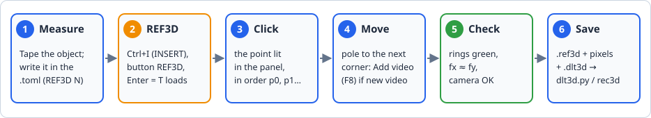
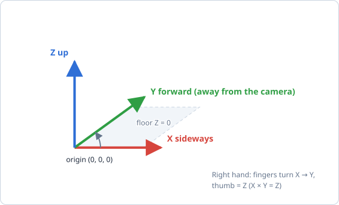
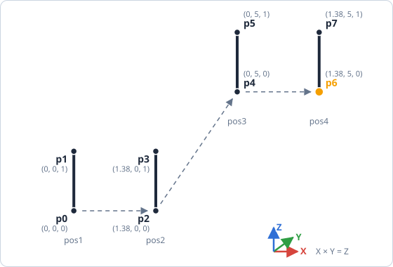
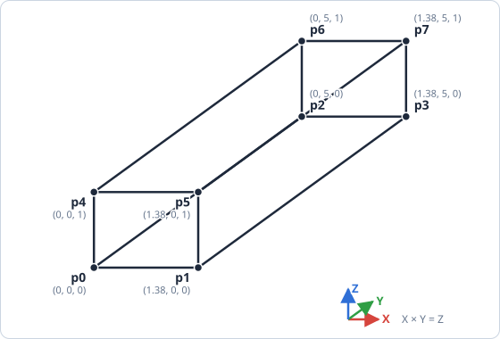
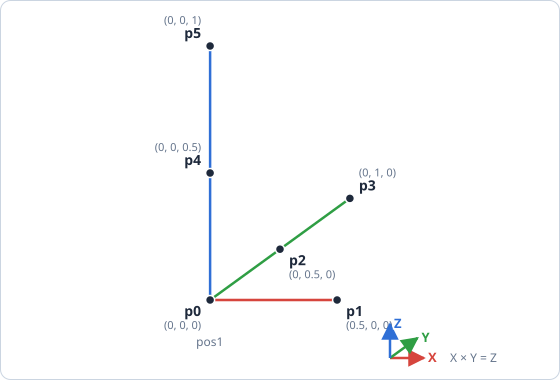
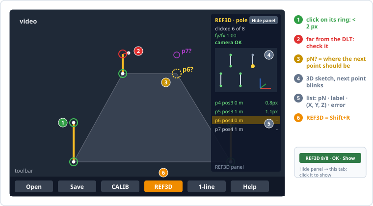
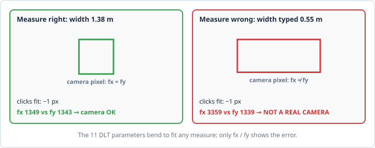

# REF3D calibration guide (illustrated)

Step-by-step DLT3D calibration with the REF3D button of getpixelvideo, with schematic drawings of the axes, the templates, the screen and the camera check.

**Version:** 0.4.19
**Date:** 16 November 2026
**Updated:** 16 November 2026
**Authors:** Prof. Dr. Paulo R. P. Santiago, Rafael L. M. Monteiro
**Project:** *vailá* - Multimodal Toolbox

[Português](ref3d_guide_pt.md)

Keep this page open next to `getpixelvideo` while you calibrate. In the window, **F1**
(with REF3D on) or the **Guide** button of the REF3D panel opens it. Tool reference:
[REF3D builder](ref3d_builder.md); keys: [getpixelvideo](getpixelvideo.md).



## 1. What you are calibrating

A DLT3D calibration links the **3D position** of known points (metres, in the `.ref3d`)
to their **pixels** in the video; with it, `rec3d` turns the pixels of any marker into
metres. You need at least **6 points that are not all on one plane**; use 8 to 12, spread
over the volume where the movement happens.

## 2. The axes and the origin



- Right-handed: X sideways, Y forward (away from the camera), Z up; X × Y = Z. Metres.
- Put the origin `(0, 0, 0)` on the floor at a corner you can see in every video.
- Swapping X and Y makes a left-handed system: the 3D reconstruction comes out mirrored.

## 3. Choose the object (template)

The drawings come from the same code as the REF3D button: `p0, p1, ...` is the order in
which you click.

**2 · Pole on a rectangle** (walkway): marks `0, 1`, positions `rect 1.38 x 5`. For each
corner, the bottom mark then the top one; corners 0,0 → X,0 → 0,Y → X,Y. The orange point
is the next one, as in the panel.



**1 · Box**: size `1.38 x 5 x 1`. Floor corners first (p0–p3), then the top (p4–p7);
inside each layer Y, then X. Marks along an axis add the points of the edges.



**3 · Triad**: X `0.5`, Y `0.5, 1`, Z `0.5, 1`. Origin, then the X, Y and Z marks; it can
be moved over a rectangle like the pole.



**L** loads a `.ref3d` you already have.

### The measures go in a template file

Write the measures once in `ref3d_template.toml`, next to the calibration videos (one
file for every `calib_pos*` video of the folder). In the first REF3D dialog, **N** writes
it with the three objects and opens it in the text editor: set `kind`, fill in your
section, save. Then REF3D + **Enter**: **T** (the default) loads it, and a typo is named
in the message (`[pole] unknown key 'mark'`). The pole of the walkway:

The file explains every key in its own comments. Axes: X sideways, Y forward (away from the camera), Z up; the origin (0, 0, 0) is a floor point. `rect = [1.4, 5]` puts the pole at (0,0), (1.4,0), (0,5) and (1.4,5).

```toml
kind = "pole"                     # the object you measured: "pole", "box" or "triad"

[pole]                            # a rod with marks, stood on the floor at several positions
marks = [0, 0.25, 0.5, 0.75, 1]   # heights of the marks, from the floor (0) up, in metres
rect = [1.4, 5]                   # X = width (sideways), Y = length (forward): 4 floor corners
# positions = [[0, 0], [1.4, 0], [0, 5]]   # or your own floor points (x, y), in click order

# Optional: where the object stood in each video (pole/triad only).
# [videos]
# "calib_pos1.mp4" = [0, 0]
# "calib_pos2.mp4" = [1.4, 0]
```

**N** writes that richer default (five marks on a 1.4 × 5 m rectangle). The walkway
drawing above still shows the short case `marks 0, 1` / `rect 1.38 x 5` (8 points): trim
`marks` to the heights you measured.

**Several videos.** Uncomment `[videos]` with one line per clip: file name → floor
`[x, y]` that must be one of the positions above. REF3D + **T** in each video then sends
clicks to that corner's points (any order). Without it, use list order + **Add video**
(F8). Only for pole and triad.

Options 1, 2, 3 (measures typed in dialogs) still work. Without a window:
`python -m vaila.ref3d_builder --new-template ref3d_template.toml`, then
`--template-file ref3d_template.toml -o calib.ref3d`.

## 4. Step by step in getpixelvideo

1. **Measure** the object with a tape (width, length, heights of the pole marks) and
   write it in `ref3d_template.toml` (REF3D **N** creates it).
2. Open the first calibration video; **Ctrl+I** (INSERT), then **REF3D** (or Shift+R, or
   CALIB option 4) and **Enter**: **T** loads the template. (1 Box, 2 Pole, 3 Triad type
   the measures; L loads a `.ref3d`.)
3. **Click** the point lit in the panel (orange in the list, blinking in the 3D sketch);
   the info line of the toolbar says `click = pN label (x, y, z)`.
4. Hidden point: **A** leaves it empty. Wrong click: right click removes the last one; a
   click on a row of the list selects that point to place it again.
5. **Move** the pole to the next corner; if it is in another video, **Add video** (F8):
   the points go along and the list continues.
6. **Check** the rings and the camera (sections 5 and 6).
7. **Save** (or Esc): pixels, `.ref3d` and `.dlt3d` next to the video.

## 5. Reading the screen



From 6 points off one plane, the DLT3D is solved at every click. Rings show where the DLT
puts each clicked point: green under 2 px, yellow under 5 px, red farther. `pN?` shows
where the points not clicked yet should be. **Hide panel** turns the panel into a small
tab with the count and the verdict.

## 6. Is it a real camera?



The 11 DLT parameters bend to fit almost any measure, so the click error alone hides a
wrong measure. A real camera has square pixels (fx ≈ fy); when they disagree the panel
says **NOT A REAL CAMERA**: measure again. (13 November 2026: width typed 0.55 m, really
1.38 m.)

| Panel says | Meaning | What to do |
| --- | --- | --- |
| camera OK, rings green | measures and clicks agree | Save |
| one ring red | that click is off | select the row, click again |
| NOT A REAL CAMERA, rings green | a measure is wrong, or X and Y swapped | measure again; check the corner order |
| needs 6 / all points on one plane | too few points, or all on the floor | add points with height |

## 7. Several videos (one position per video)

Two ways:

1. **`[videos]` in the template** (preferred): name each file and its floor corner; open
   that video, REF3D + **T**, click only that corner's marks.
2. **List order + F8:** click pos1 in the first video, **Add video** (F8), open the next,
   continue the list.

The camera must not move between the videos.

## 8. Files and next step

| File (next to the video on screen) | Content |
| --- | --- |
| `<video>_markers_1_line.csv` + `.toml` | pixels of p0, p1, ... and where each was clicked |
| `<video>_markers_1_line.ref3d` | the 3D points, metres |
| `ref3d_template.toml` (folder of the videos) | the measures you fill in; N writes it, T loads it |
| `<video>_markers_1_line.template.toml` | the measures used, same format |
| `<video>_markers_1_line.dlt3d` | the 11 DLT3D coefficients |

Use the `.dlt3d` in **DLT/REC 2D-3D** (`rec3d`). Existing files are copied to
`.vaila_markers_history/` first.

## 9. Common mistakes

- A measure typed wrong: rings green, camera NOT REAL.
- X and Y swapped, or corners clicked out of order: follow the lit point.
- All points on the floor: no 3D calibration; use the pole top or the Z arm.
- Fewer than 6 points, or exactly 6: no check; use 8 to 12.
- A hidden point clicked at a guess: use **A**.
- Strong lens distortion: not modelled; keep points away from the image edges.

The drawings are schematic (fixed oblique view). They are made by
`bin/make_ref3d_guide_svgs.py` from `vaila/ref3d_builder.py`.
