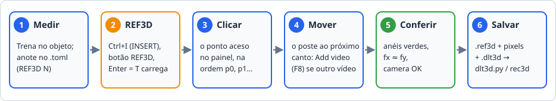
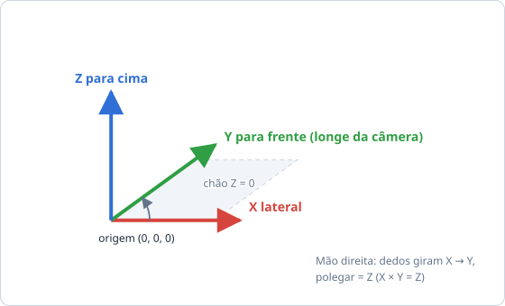
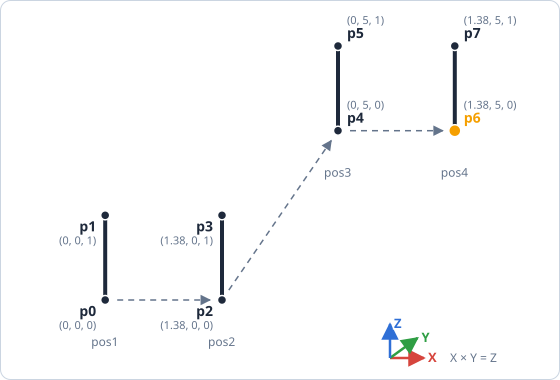
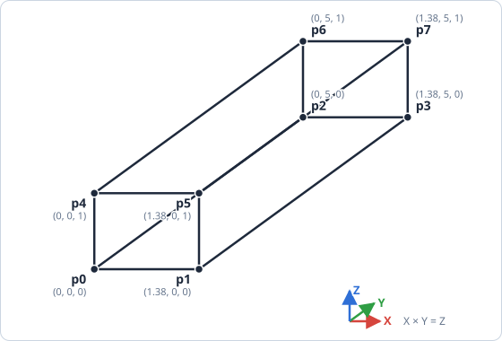
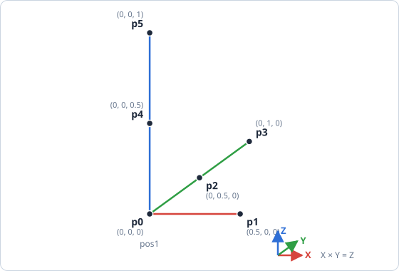
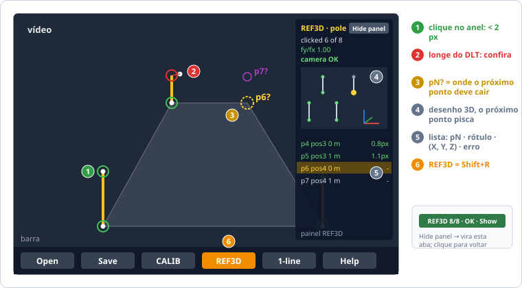
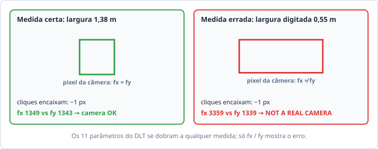

# Guia de calibração REF3D (ilustrado)

Passo a passo da calibração DLT3D com o botão REF3D do getpixelvideo, com desenhos esquemáticos dos eixos, dos gabaritos, da tela e da conferência da câmera.

**Versão:** 0.4.18
**Data:** 15 de novembro de 2026
**Atualizado:** 15 de novembro de 2026
**Autores:** Prof. Dr. Paulo R. P. Santiago, Rafael L. M. Monteiro
**Projeto:** *vailá* - Multimodal Toolbox

[English](ref3d_guide.md)

Deixe esta página aberta ao lado do `getpixelvideo` enquanto calibra. Na janela, **F1**
(com o REF3D ligado) ou o botão **Guide** do painel REF3D abre esta página. Referência:
[REF3D builder](ref3d_builder.md); teclas: [getpixelvideo](getpixelvideo_pt.md).



## 1. O que se calibra

A calibração DLT3D liga a **posição 3D** de pontos conhecidos (metros, no `.ref3d`) aos
seus **pixels** no vídeo; com ela, o `rec3d` transforma os pixels de qualquer marcador em
metros. São precisos pelo menos **6 pontos que não estejam todos num plano**; use de 8 a
12, espalhados pelo volume do movimento.

## 2. Os eixos e a origem



- Mão direita: X lateral, Y para frente (longe da câmera), Z para cima; X × Y = Z. Metros.
- Ponha a origem `(0, 0, 0)` no chão, num canto que apareça em todos os vídeos.
- Trocar X com Y dá um sistema de mão esquerda: a reconstrução 3D sai espelhada.

## 3. Escolha o objeto (gabarito)

Os desenhos saem do mesmo código do botão REF3D: `p0, p1, ...` é a ordem dos cliques.

**2 · Poste num retângulo** (passarela): marcas `0, 1`, posições `rect 1.38 x 5`. Em cada
canto, a marca de baixo e depois a de cima; cantos 0,0 → X,0 → 0,Y → X,Y. O ponto
laranja é o próximo, como no painel.



**1 · Caixa**: tamanho `1.38 x 5 x 1`. Primeiro os cantos do chão (p0–p3), depois os de
cima (p4–p7); em cada camada, Y e depois X. Marcas num eixo acrescentam os pontos das
arestas.



**3 · Triedro**: X `0.5`, Y `0.5, 1`, Z `0.5, 1`. Origem, depois as marcas de X, Y e Z;
pode ser movido sobre um retângulo como o poste.



**L** carrega um `.ref3d` que você já tem.

### As medidas ficam num arquivo de template

Escreva as medidas uma vez no `ref3d_template.toml`, ao lado dos vídeos de calibração (um
arquivo para todos os vídeos `calib_pos*` da pasta). No primeiro diálogo do REF3D, **N**
grava o arquivo com os três objetos e o abre no editor de texto: escolha o `kind`,
preencha a sua seção e salve. Depois, REF3D + **Enter**: **T** (o padrão) carrega, e um
erro de digitação aparece na mensagem (`[pole] unknown key 'mark'`). O poste da passarela:

```toml
kind = "pole"             # "pole", "box" or "triad"

[pole]                    # a rod with marks, stood at several floor positions
marks = [0, 1]            # heights of the marks, bottom to top
rect = [1.38, 5]          # the 4 corners of X x Y: 0,0 / X,0 / 0,Y / X,Y
# positions = [[0, 0], [1, 0], [0, 5]]  # or your own list (x, y), in click order
```

As opções 1, 2, 3 (medidas digitadas em diálogos) continuam. Sem janela:
`python -m vaila.ref3d_builder --new-template ref3d_template.toml` e depois
`--template-file ref3d_template.toml -o calib.ref3d`.

## 4. Passo a passo no getpixelvideo

1. **Meça** o objeto com a trena (largura, comprimento, alturas das marcas do poste) e
   anote no `ref3d_template.toml` (o REF3D **N** cria o arquivo).
2. Abra o primeiro vídeo de calibração; **Ctrl+I** (INSERT), depois **REF3D** (ou
   Shift+R, ou a opção 4 do CALIB) e **Enter**: **T** carrega o template. (1 Caixa,
   2 Poste, 3 Triedro para digitar as medidas; L carrega um `.ref3d`.)
3. **Clique** o ponto aceso no painel (laranja na lista, piscando no desenho 3D); a linha
   de informação da barra diz `click = pN rótulo (x, y, z)`.
4. Ponto escondido: **A** deixa em branco. Clique errado: o botão direito remove o
   último; clicar numa linha da lista seleciona aquele ponto para recolocar.
5. **Mova** o poste para o próximo canto; se ele está em outro vídeo, **Add video** (F8):
   os pontos vão junto e a lista continua.
6. **Confira** os anéis e a câmera (seções 5 e 6).
7. **Save** (ou Esc): pixels, `.ref3d` e `.dlt3d` ao lado do vídeo.

## 5. Como ler a tela



A partir de 6 pontos fora de um plano, o DLT3D é calculado a cada clique. Os anéis
mostram onde o DLT coloca cada ponto clicado: verde abaixo de 2 px, amarelo abaixo de
5 px, vermelho mais longe. `pN?` mostra onde devem estar os pontos ainda não clicados.
**Hide panel** recolhe o painel numa aba com a contagem e o veredito.

## 6. É uma câmera real?



Os 11 parâmetros do DLT se dobram a quase qualquer medida, então o erro dos cliques,
sozinho, esconde uma medida errada. Câmera real tem pixel quadrado (fx ≈ fy); quando
discordam, o painel diz **NOT A REAL CAMERA**: meça de novo. (13 de novembro de 2026:
largura digitada 0,55 m, real 1,38 m.)

| O painel diz | Significa | O que fazer |
| --- | --- | --- |
| camera OK, anéis verdes | medidas e cliques concordam | Save |
| um anel vermelho | aquele clique está fora | selecione a linha, clique de novo |
| NOT A REAL CAMERA, anéis verdes | medida errada, ou X e Y trocados | meça de novo; confira a ordem dos cantos |
| needs 6 / todos num plano | poucos pontos, ou todos no chão | acrescente pontos com altura |

## 7. Vários vídeos (uma posição por vídeo)

Clique os pontos da pos1 no primeiro vídeo, **Add video** (F8), abra o próximo e
continue. A câmera não pode se mexer entre os vídeos.

## 8. Arquivos e próximo passo

| Arquivo (ao lado do vídeo na tela) | Conteúdo |
| --- | --- |
| `<video>_markers_1_line.csv` + `.toml` | pixels de p0, p1, ... e onde cada um foi clicado |
| `<video>_markers_1_line.ref3d` | os pontos 3D, metros |
| `ref3d_template.toml` (pasta dos vídeos) | as medidas que você preenche; N gera, T carrega |
| `<video>_markers_1_line.template.toml` | as medidas usadas, mesmo formato |
| `<video>_markers_1_line.dlt3d` | os 11 coeficientes do DLT3D |

Use o `.dlt3d` no **DLT/REC 2D-3D** (`rec3d`). Arquivos que já existiam são copiados antes
para `.vaila_markers_history/`.

## 9. Erros comuns

- Medida digitada errada: anéis verdes, câmera NOT REAL.
- X e Y trocados, ou cantos fora de ordem: siga o ponto aceso.
- Todos os pontos no chão: sem calibração 3D; use o topo do poste ou a haste Z.
- Menos de 6 pontos, ou exatamente 6: sem conferência; use de 8 a 12.
- Ponto escondido clicado no chute: use **A**.
- Lente com muita distorção: não é modelada; mantenha os pontos longe das bordas.

Os desenhos são esquemáticos (vista oblíqua fixa). São feitos pelo
`bin/make_ref3d_guide_svgs.py` a partir do `vaila/ref3d_builder.py`.
